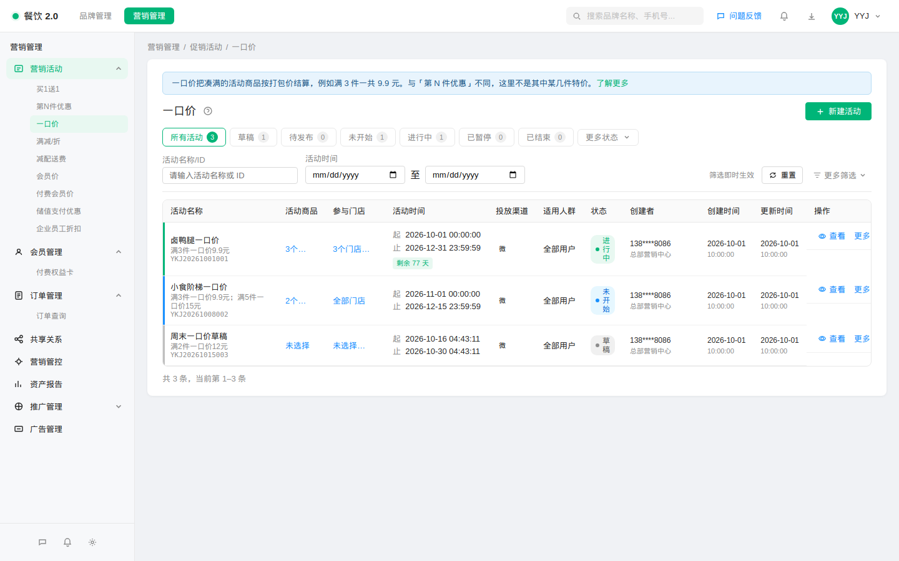
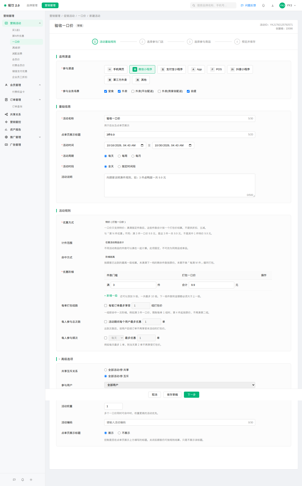
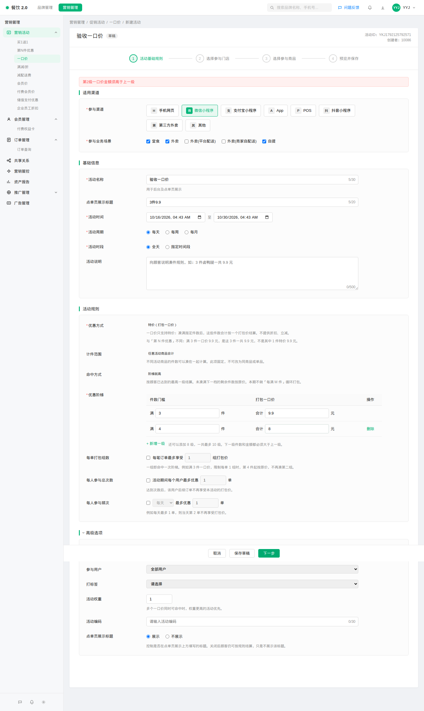
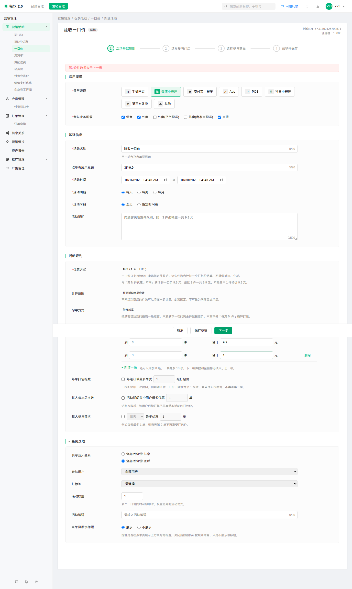
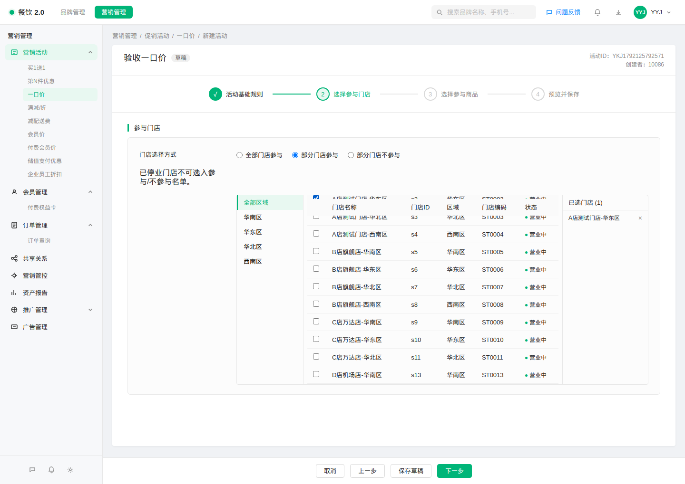
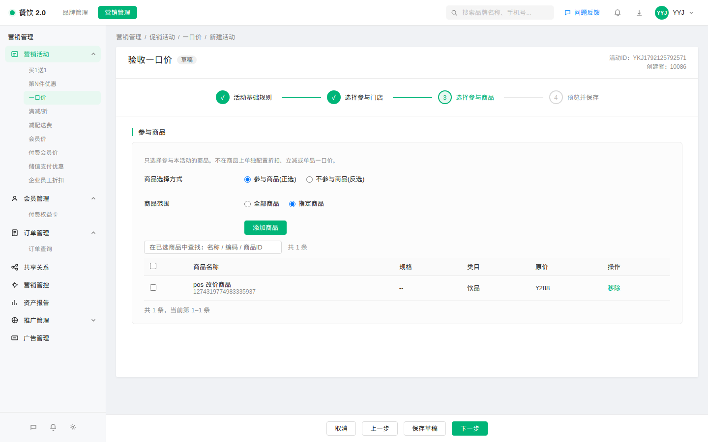
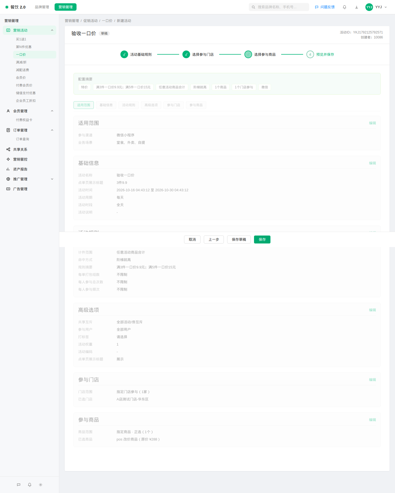
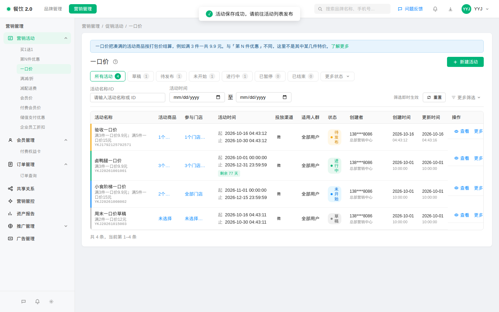

# 【PRD】一口价（商家端）

## 一、文档信息

| 字段 | 内容 |
|---|---|
| 文档状态 | 已确认（对照已交付原型整理） |
| 版本号 | v1.0 |
| 作者 | 产品 |
| 创建时间 | 2026-10-16 |
| 目标上线时间 | TBD |
| 相关团队 | 产品 / 设计 / 研发 / 测试 / 运营 |
| 相关原型 | 促销后台 · 营销活动 · 一口价 |

## 二、变更日志

| 时间 | 版本号 | 变更人 | 主要变更内容 | 同步状态 |
|---|---|---|---|---|
| 2026-10-16 | v1.0 | 产品 | 初稿：商家端一口价列表与四步配置；约定消费者端对客表现，本期不做出消费者端页面 | 已确认 |

## 三、背景与问题定义

### 3.1 背景说明

品牌运营需要配置「凑满指定件数，整组按一个打包价结算」的促销。典型话术是「3 件卤鸭腿一共 9.9 元」。

现有活动解决不了这件事：

- 「第 N 件优惠」凑满件数后，只对其中若干件做折扣、立减或特价。顾客理解成「第 3 件只要 9.9」，不是「这 3 件一共 9.9」。
- 会员价、储值支付优惠里的一口价是单品固定价，不是按件数打包。
- 「满减/折」是满金额或满件数后减钱、打折，语义不是打包票价。

### 3.2 问题陈述

> 运营无法把「若干件活动商品合计一个价格」配成独立促销。若借用第 N 件优惠的特价，顾客和店员都会把打包价理解成单件特价，造成对客承诺和实际结算不一致。

### 3.3 为什么现在做

门店已在用「几件一共多少钱」做档期。没有独立活动类型时，运营只能改文案硬凑，规则和话术对不上，复盘和暂停也跟其他活动不一致。

### 3.4 目标用户与场景

| 用户/角色 | 场景 | 痛点 | 期望结果 |
|---|---|---|---|
| 品牌运营 | 配置「3 件卤鸭腿 9.9」 | 现有活动表达的是单件特价或满减 | 配成「满 3 件合计 9.9 元」并选门店、商品 |
| 品牌运营 | 同一活动做多档，如 3 件 9.9、5 件 15 | 无法表达越高档越划算的打包价 | 最多 10 级，按已达到的最高一级结算 |
| 品牌运营 | 活动进行中要临时停卖 | 只能作废 | 可暂停，改完再恢复 |
| 顾客 | 点单凑件数 | 看不懂是单件价还是合计价 | 看到「3 件 9.9」这类合计口径（本期只约定，不做顾客端页面） |

## 四、目标与成功指标

### 4.1 产品目标

- 在「营销活动」下提供独立的「一口价」：列表管理 + 四步配置。
- 规则语义固定为：活动商品凑满 M 件，这 M 件合计 N 元。
- 优惠方式只有特价，不出现折扣、立减。
- 生命周期与同类活动对齐：草稿、待发布、未开始、进行中、已暂停、已结束、已作废；支持新建、编辑、复制、发布、暂停、恢复、作废、草稿删除、查看。

### 4.2 非目标

- 本期不对接真实计价，原型用本地演示数据即可。
- 本期不做消费者端点单页或购物袋 Demo。对客怎么展示、怎么算，写在本文第十一章，供后续消费者端排期。
- 不把一口价并进「第 N 件优惠」。
- 不做「每满 M 件再打包一组」的循环。循环放后续迭代。
- 计件范围不做开关，固定为任意活动商品合计。

### 4.3 成功指标

| 指标 | 当前值 | 目标值 | 统计口径 | 观测周期 |
|---|---|---|---|---|
| 打包价能否独立配置 | 不能，只能借用其他活动 | 运营可独立新建并在列表看到「满 3 件一口价 9.9 元」 | 配置验收 | 上线验收 |
| 与第 N 件特价的混淆 | 文案容易看成单件价 | 配置页和列表摘要能区分「合计价」与「其中 N 件特价」 | 文案走查 | 上线验收 |
| 错误阶梯能否被拦住 | 无此活动 | 件数或金额不递增时不能进入下一步 | 配置验收 | 上线验收 |

## 五、范围与方案概述

| 范围类型 | 内容 |
|---|---|
| 本期要做 | 商家端入口、列表、四步向导、阶梯校验、暂停/恢复等生命周期 |
| 本期不做 | 消费者端页面；真实结算；每满循环；计件范围配置 |
| 后续 | 消费者端按第十一章落地；如需「每满循环」单独开需求 |

配置顺序：基础信息与规则 → 参与门店 → 参与商品 → 预览并保存。

## 六、角色与场景

- **品牌运营**：创建和维护活动，决定渠道、场景、门店、商品和打包价。
- **店长**：不在本期单独做店长端。门店是否参与由品牌在活动里指定。
- **顾客**：本期不提供可点击的顾客页面。对客看到的标签、未凑满、凑满、多买几件时怎么算，按第十一章执行。

## 七、主流程

1. 运营从「营销活动 → 一口价」进入列表。
2. 点击「新建活动」。
3. 填写名称、时间、渠道、业务场景，配置「满 M 件，合计 N 元」。需要多档时逐级添加。
4. 选择参与门店：全部门店、指定门店参与，或指定门店不参与。
5. 选择参与商品。商品行只展示商品信息和原价，不在商品上再配优惠。
6. 预览核对摘要，保存。新建保存后为「待发布」。
7. 回到列表，规则摘要可见。运营再点「发布」。到了开始时间且未到结束时间为「进行中」，未到开始时间为「未开始」。
8. 进行中可暂停。暂停期间顾客享受不到该活动。恢复后按当前时间重新判断是未开始、进行中，还是已经结束。

草稿可随时保存，不要求填完。草稿可删除。已发布活动再次编辑保存后，保持原状态，不会被打回待发布。

## 八、功能与页面交互

### 8.1 列表

侧栏名称为「一口价」。

**状态页签**：所有活动、草稿、待发布、未开始、进行中、已暂停、已结束；更多状态里含已作废。页签与列表筛选联动，并显示数量。

**筛选**

| 条件 | 用户怎么用 | 命中规则 |
|---|---|---|
| 活动名称 / 编号 | 输入关键字 | 名称或活动编号包含该关键字 |
| 活动时间 | 选择起止日期 | 与活动有效期有交集即命中 |
| 活动商品名称 | 更多筛选中填写 | 参与商品名称包含关键字；全部商品时按商品库匹配 |
| 活动商品编号 | 更多筛选中填写 | 商品编号匹配 |
| 活动编码 | 更多筛选中填写 | 活动编码包含关键字 |

筛选即时生效，可重置。

**列表展示**

- 活动名称下方展示规则摘要。单档示例：`满3件一口价9.9元`。两到三档用分号连起来，例如 `满3件一口价9.9元；满5件一口价15元`。超过三档时展示「N 级阶梯」以及最高一档。
- 同时展示活动商品数量、参与门店、起止时间、投放渠道、适用人群、状态、创建者、创建时间、更新时间。
- 点击商品数或门店数，可查看当时圈选的商品或门店。商品快照展示名称、规格、原价，不展示单品优惠。

**行内操作**

| 状态 | 查看 | 编辑 | 复制 | 发布 | 暂停 | 恢复 | 作废 | 删除 |
|---|---|---|---|---|---|---|---|---|
| 草稿 | 有 | 有 | 有 | 有 | — | — | — | 有 |
| 待发布 | 有 | 有 | 有 | 有 | — | — | 有 | — |
| 未开始 | 有 | 有 | 有 | — | — | — | 有 | — |
| 进行中 | 有 | 有 | 有 | — | 有 | — | 有 | — |
| 已暂停 | 有 | 有 | 有 | — | — | 有 | 有 | — |
| 已结束 | 有 | — | 有 | — | — | — | — | — |
| 已作废 | 有 | — | 有 | — | — | — | — | — |

- **复制**：生成一条新草稿，名称后加「(副本)」，规则、门店、商品一并带上。
- **发布**：按当前时间落成未开始、进行中或已结束。
- **暂停**：二次确认。确认后的影响说明为「顾客暂时无法享受本活动的打包一口价」。已经过了结束时间的活动不必暂停。
- **恢复**：二次确认。若暂停期间已经过了结束时间，恢复后直接标为已结束，并说明是暂停期间到期。
- **作废**：二次确认，作废后不可恢复。
- **删除**：仅草稿，二次确认后删除。
- 暂停时间过长时，列表顶部提醒运营有活动尚未恢复。

### 8.2 步骤一：基础信息与规则

**参与范围**

- 参与渠道可多选，至少选 1 个。
- 参与业务场景可多选，至少选 1 个。场景与现有活动一致，包含堂食、外卖、自提等。

**基础信息**

- 活动名称必填，最多 30 字。
- 点单页展示标题选填，最多 20 字。建议写成顾客能看懂的短句，如「3件9.9」。
- 活动时间必填，结束时间必须晚于开始时间。
- 活动周期：每天 / 每周 / 每月。
- 活动时段：全天 / 指定时间段。
- 活动说明选填，最多 500 字，用于向顾客解释凑件规则。

**优惠规则（本活动的差异点）**

- 优惠方式固定为「特价（打包一口价）」。页面只展示这一项，不提供折扣、立减，也不能改成其他方式。
- 旁边说明与第 N 件的差别：满 3 件一口价 9.9 元，是这 3 件一共 9.9 元，不是其中 1 件 9.9 元。
- 计件范围固定为「任意活动商品合计」，只读。不同活动商品的件数可以加在一起，不能改成「必须同一商品」。
- 命中方式固定为「阶梯就高」，只读。按顾客已经达到的最高一级结算。没有凑满下一档的剩余件数按原价。本期没有「每满再来一组」的循环开关。
- 阶梯表格：每一级是「满 [件数] 件，合计 [金额] 元」。默认带出一级「满 3 件，合计 9.9 元」，运营可改。
- 可新增、可删除。第一级不能删。最多 10 级。
- 新增下一级时，件数和金额先按「比上一级更大」预填，运营仍可修改；点下一步时再校验。

**限购**

- 每单打包组数：默认不限制。勾选后可填「每笔订单最多享受几组」。一组就是命中一次阶梯。例如满 3 件、每单限 1 组时，第 4 件起按原价，不再凑第二组。
- 每人活动期间最多优惠单数：默认不限制。
- 每人按天 / 周 / 月最多优惠单数：默认不限制。

**高级选项**（默认收起）

- 与其他活动、券全部共享，或全部互斥。
- 参与用户、参与后打标签。
- 活动权重：多个一口价都能命中时，权重更高的优先。
- 活动编码。
- 点单页是否展示上面填写的标题。选「不展示」时，顾客仍按规则结算，只是不展示该标题。

### 8.3 步骤二：参与门店

- 全部门店参与 / 指定门店参与 / 指定门店不参与。
- 指定时至少选 1 家。已停业门店不能新选入。
- 选择器与现有活动相同：按区域找门店，可搜索，右侧能看到已选。

### 8.4 步骤三：参与商品

- 页面说明：这里只选参加本活动的商品，不在商品上再配折扣、立减或单品一口价。
- 可选全部商品，或指定商品。指定时可正选（这些商品参加）或反选（这些商品不参加）。
- 指定商品时至少选 1 个。已选列表展示商品名称、规格、类目、原价，可搜索、分页、批量移除。
- 不出现「这个商品走一口价 / 这个商品走原价」的单品开关。没被圈进活动的商品本来就按原价。

### 8.5 步骤四：预览并保存

预览汇总：渠道与场景、名称与时间、优惠方式、计件范围、命中方式、规则摘要、限购、共享关系、门店、商品及原价。每一块可以返回对应步骤修改。

底部：取消、上一步、保存草稿、保存。

保存成功后回到列表。新建的活动状态为待发布，名称下能看到规则摘要。

查看已有活动时直接打开预览，可再进入编辑（已结束、已作废除外）。

## 九、业务规则

### 9.1 打包价怎么理解

- 门槛只按件数，不按金额。
- 达到某一级的 M 件后，这 M 件合计付 N 元，不是每件 N 元，也不是只给其中 1 件特价。
- 件数把本活动里的商品加总，不要求是同一个商品。例如活动商品是鸭腿和鸭翅，2 个鸭腿 + 1 个鸭翅可以凑满 3 件。
- 多级时只使用已经达到的最高一级，不把低级别再套一次。
- 不够下一级的剩余件数按原价，不循环。

举例：原价 12 元/件，规则为「满 3 件 9.9 元，满 5 件 15 元」。

| 购买件数 | 顾客应付 |
|---|---|
| 1～2 件 | 全部原价 |
| 3 件 | 9.9 元 |
| 4 件 | 9.9 元 + 1 件原价 |
| 5 件及以上且未限组数 | 达到 5 件的按 15 元；若买 6 件且每单不限组数，则 15 元 + 1 件原价 |
| 每单限 1 组，买 6 件 | 只享受一组最高已达档，其余按原价 |

「每满 3 件再来一组 9.9」本期不支持。买 6 件不会自动变成两个 9.9。

### 9.2 阶梯校验

点「下一步」或最终保存时检查，不通过则留在当前步并提示：

- 至少 1 级，最多 10 级。
- 件数必须是大于 0 的整数。
- 金额必须大于 0。
- 下一级件数必须大于上一级。
- 下一级金额必须高于上一级。9.9 后面不能再填 9.9 或 8。

优惠方式、计件范围、命中方式都不可改，因此不存在「选成折扣」或「选成每满循环」的入口。

### 9.3 其他校验

- 活动名称必填。
- 结束时间晚于开始时间。
- 渠道、业务场景都至少 1 项。
- 非全部门店时至少 1 家门店。
- 非全部商品时至少 1 个商品。
- 若开启限购，次数和组数都要大于 0。

### 9.4 状态

与现有促销活动相同：暂停不延长结束时间。暂停中如果到了结束时间，活动变为已结束，列表可看到是在暂停期间到期的。

草稿、待发布不对顾客生效。作废、已结束不对顾客生效。暂停期间不对顾客生效。

## 十、异常与边界

| 情况 | 系统怎么处理 | 用户看到什么 |
|---|---|---|
| 名称、时间、渠道、场景没填完就下一步 | 停在第一步 | 对应的必填提示 |
| 阶梯件数或金额没有递增 | 停在第一步 | 「第 N 级件数须大于上一级」或「第 N 级一口价金额须高于上一级」 |
| 已到 10 级还想加 | 新增按钮不可用 | 提示最多 10 级 |
| 指定门店或指定商品却没选 | 停在对应步骤 | 请至少选择一个门店 / 商品 |
| 活动已过结束时间还要点暂停 | 不进入暂停 | 提示已过结束时间，无需暂停 |
| 暂停期间过了结束时间再恢复 | 变为已结束 | 提示已过结束时间，直接标记为已结束 |
| 作废、删除 | 二次确认 | 作废不可恢复；删除仅针对草稿 |
| 进行中直接改规则 | 允许编辑并保存，状态仍为进行中 | 保存后按新规则生效。若希望先停售再改，应先暂停 |
| 复制 | 新草稿 | 需重新保存、发布后才会对客 |
| 无进行中的一口价，或门店、渠道、场景不匹配 | 不享受 | 顾客按原价 |

## 十一、消费者端对客表现（本期只约定，不做出页面）

消费者端后续按下面口径实现。本期商家端不提供可预览的点单页。

### 11.1 什么时候看得到、享受得到

同时满足才生效：

- 活动已发布，且当前在有效期内、处于进行中（未暂停、未作废、未结束）。
- 下单渠道、业务场景在活动范围内。
- 下单门店在参与范围内（含「指定门店不参与」的排除逻辑）。
- 商品属于活动商品（全部商品，或正选命中，或反选未命中排除名单）。
- 用户还没超出「每人总次数」和「每人频次」。
- 活动商品合计件数达到至少第一级门槛。

任一不满足：不展示可享受的结算结果，相关商品按原价。草稿、待发布一律不对客。

### 11.2 顾客看到的文案

- 点单页商品标签、购物袋促销文案使用「合计价」口径，例如「3件9.9」。有填写点单页标题且选择展示时，优先展示该标题。
- 不要写成「第 3 件 9.9」或「其中 1 件 9.9」。那是第 N 件优惠的说法。
- 多级时，标签展示顾客当前已达到的最高一级；未达到任何一级时，可展示最低一级作为凑单提示，例如「满 3 件 9.9」，并让顾客能看出还差几件。具体凑单进度的交互由消费者端方案细化，但数字口径必须是合计价。
- 活动说明若有填写，可在活动详情或规则弹层中展示。

### 11.3 怎么算

- 只按件数门槛，件数 = 本单活动商品件数之和。
- 命中已达到的最高一级：这 M 件合计 N 元。
- 多出来、又不够下一级的件数，按原价另计。
- 若限制了每单组数，超出组数的件数全部原价，不能靠再买一组继续吃打包价。本期没有「每满循环」，不限组数时也只吃到最高一级一次，剩余件数原价。
- 多个一口价同时可命中时，用活动权重更高的一个。权重相同的处理留给计价方案，商家端需保留权重字段。
- 与其他活动、券是全部共享还是全部互斥，按活动里的选择执行。

### 11.4 和「满 3 件其中 1 件特价 9.9」的差别（对客必须能区分）

| | 一口价 | 第 N 件优惠（特价） |
|---|---|---|
| 配置话术 | 满 3 件一口价 9.9 元 | 满 3 件，其中 1 件特价 9.9 元 |
| 顾客理解 | 这 3 件一共 9.9 | 有 1 件只要 9.9，另外 2 件原价 |
| 标签建议 | 3件9.9 | 第3件9.9 |

## 十二、关键文案与显隐

| 位置 | 文案 | 何时出现 |
|---|---|---|
| 侧栏、列表标题 | 一口价 | 始终 |
| 列表规则摘要 | 满3件一口价9.9元 | 单档 |
| 列表规则摘要 | 满3件一口价9.9元；满5件一口价15元 | 2～3 档 |
| 列表规则摘要 | N级阶梯，最高满X件一口价Y元 | 超过 3 档 |
| 规则区 | 特价（打包一口价） | 始终，不可切换 |
| 规则区说明 | 不提供折扣、立减；与第 N 件不同，是合计价 | 配置第一步始终展示 |
| 规则区 | 任意活动商品合计 | 始终，不可切换 |
| 规则区 | 阶梯就高 | 始终，不可切换；说明剩余件数原价、本期不做每满循环 |
| 校验 | 第N级件数须大于上一级 | 件数未递增 |
| 校验 | 第N级一口价金额须高于上一级 | 金额未升高 |
| 商品步 | 只选择参与商品，不配置单品优惠 | 第三步始终展示 |
| 暂停确认 | 顾客暂时无法享受本活动的打包一口价 | 确认暂停时 |
| 恢复确认 | 顾客可立即重新享受本活动的打包一口价 | 恢复后仍会生效时 |
| 列表帮助 | 说明合计打包价、阶梯就高、无折扣立减、无每满循环 | 点击帮助 |

点单页标题的「不展示」只隐藏标题，不隐藏结算。活动说明为空时，预览里显示为空，不编造说明。

## 十三、验收标准

1. 侧栏「营销活动」下有「一口价」，打开后是活动列表，能看到规则摘要「满3件一口价9.9元」。
2. 能新建活动：名称自定，规则为满 3 件、合计 9.9 元，选至少 1 家门店、至少 1 个商品，保存后列表出现该活动，摘要为「满3件一口价9.9元」。
3. 再加一级时，件数不大于上一级，或金额不高于上一级，都不能进入下一步，并出现对应提示。
4. 规则区看不到折扣、立减的可选项，也看不到「每满循环」开关；计件范围不能改。
5. 商品步没有单品折扣、立减、单品一口价，也没有「一口价 / 原价」单选。
6. 预览中的规则、门店、商品与前面填写的一致。
7. 草稿可删除；待发布可发布、可作废；进行中可暂停，暂停后可恢复。
8. 列表摘要能和第 N 件优惠的「其中 N 件特价」区分开。
9. 本文第十一章作为消费者端的验收依据：后续做出顾客端时，凑满 3 件应按合计 9.9 结算，而不是只给 1 件 9.9。
