# 【PRD】促销活动运营效率优化（暂停/恢复 · 已选商品检索 · 跨活动参与记录 · 付费会员价草稿）

## 一、文档信息

| 字段 | 内容 |
|---|---|
| 文档状态 | 已确认（对照已交付原型整理） |
| 版本号 | v1.3 |
| 作者 | 产品 |
| 创建时间 | 2026-09-10 |
| 目标上线时间 | TBD |
| 相关团队 | 产品 / 设计 / 研发 / 测试 / 运营 |
| 相关链接 | 商家端促销后台原型：https://promo.yangyaojun-demo.cn/ |

## 二、变更日志

| 时间 | 版本号 | 变更人 | 主要变更内容 | 同步状态 |
|---|---|---|---|---|
| 2026-09-10 | v1.0 | 产品 | 初建：合并「暂停/恢复」「已选商品检索」「跨活动参与记录」三点需求 | 待评审 |
| 2026-09-10 | v1.1 | 产品 | 补充「付费会员价支持草稿状态」 | 待评审 |
| 2026-09-10 | v1.2 | 产品 | 确认能力范围：暂停/检索/跨活动参与记录（含导出）覆盖全部促销活动类型；补齐原型外活动清单 | 已确认 |
| 2026-09-10 | v1.3 | 产品 | 补充原型截图（暂停/恢复、已选商品检索、跨活动参与记录、付费会员价草稿） | 已确认 |

## 三、背景与问题定义

### 3.1 背景说明

促销后台承载全量促销活动的配置与运营（含买1送N、第N件优惠、满减/折、会员价、付费会员价，以及限时折扣、满赠、特惠加购等更多类型，完整清单见 5.1）。活动上线后，品牌运营经常需要：

1. 在业务低峰或规则调整窗口，临时让活动对顾客不生效，改完再恢复；
2. 在「部分商品」场景下维护成百上千个已选商品，快速定位某一个商品；
3. 按活动类型统一查看、导出参与记录，而不是逐个活动进出；
4. 针对付费会员价：在旧活动仍生效时，先把新规则配成草稿，再作废旧活动并发布新活动，实现平滑替换。

现状分别对应效率瓶颈：活动只能作废或硬改进行中规则、已选列表只能翻页查找、参与记录只能单活动查看；付费会员价若缺少草稿，则无法在旧活动仍生效时安全预配新规则。

### 3.2 问题陈述

> 当前品牌运营在活动维护、商品核对、参与数据复盘、付费会员价换挡场景下，缺少「临时下线—改规则—恢复」「已选商品快速定位」「同类型多活动一次查记录」「付费会员价半成品草稿与平滑替换」能力，导致改规则风险高、找商品慢、导出参与数据成本高、换挡只能硬切。

### 3.3 为什么现在做

- 活动数量增多后，单活动逐个操作的人工成本已不可接受（参与记录场景常见 50+ 活动）。
- 「进行中直接改规则」缺少缓冲态，运营不敢改、改错影响面大。
- 「部分商品」配置规模增大后，无检索能力已成为配置环节的硬阻塞。
- 付费会员价与卡权益强绑定、无起止时间，换挡依赖「新活动配好 → 旧活动作废 → 新活动发布」，草稿是该链路的前置能力。

### 3.4 目标用户与场景

| 用户/角色 | 场景 | 痛点 | 期望结果 |
|---|---|---|---|
| 品牌运营 | 进行中活动要临时调整规则/商品 | 不敢直接改，或只能作废重建 | 可暂停 → 改完恢复 |
| 品牌运营 | 已选商品 100～500+ | 只能翻页找某一个商品 | 按名称/编码/ID 即时筛选 |
| 品牌运营 / 数据分析 | 复盘某类活动参与情况 | 逐个活动进参与记录再导出 | 按活动类型一次查询、筛选、导出 |
| 品牌运营 | 付费会员价要替换规则/商品/力度 | 旧活动仍在生效时无法预配新活动 | 先存草稿，配好后再发布替换 |

## 四、目标与成功指标

### 4.1 产品目标

- **全量促销活动类型**统一支持可逆的「已暂停」状态，暂停期间该活动对顾客不生效；有结束时间的活动，暂停期间到期自动转「已结束」。
- **全量促销活动类型**在新建/编辑时，凡存在「已选商品」列表的，均支持关键词检索，并明确筛选态下批量操作作用域。
- **全量促销活动类型**均提供活动类型维度的参与记录查询，支持跨多个活动 ID 查看，并支持按当前筛选结果导出。
- 为付费会员价补充「草稿」状态，支持半成品保存、可删除、发布后进入待发布/进行中，并支持旧活动仍生效时预配替换活动。

### 4.2 非目标

- 本期不改造消费者端价格/优惠引擎的完整定价链路说明（仅约定：暂停期间该活动优惠不生效；草稿不对客生效）。
- 本期不新增独立「下载中心」产品；导出沿用现有「创建导出任务」交互，但**所有活动类型的参与记录页都必须具备导出入口与能力**。
- 本期不展开付费会员价的完整专项（卡模版权益配置、额度售后、CRM 全链路等），仅补齐「草稿」相关状态与交互口径；其余以付费会员价专项需求为准。
- 本期不以「按用户维度的全站参与画像」为目标；不做跨活动类型混合查询（如买1送N + 满减一次查）。
- 当前原型不必补齐全部活动类型的页面与数据，但正式产品需求以「全量活动类型均需支持」为准（见 5.1）。

### 4.3 成功指标

| 指标 | 当前值 | 目标值 | 统计口径 | 观测周期 |
|---|---|---|---|---|
| 活动规则调整平均耗时 | TBD | 下降（定性：暂停→改→恢复可在一次会话完成） | 运营访谈 / 操作日志 | 上线后 2 周 |
| 已选商品定位耗时 | 需翻页查找 | 输入关键词后 ≤ 3 秒内定位 | 可用性抽测 | 上线验收 |
| 多活动参与记录导出次数 | 需按活动重复导出 | 同类型一次导出覆盖所需活动 | 运营反馈 | 上线后 2 周 |
| 暂停超时未恢复活动数 | TBD | 可被列表提醒发现并处理 | 列表超时提醒 | 日常运营 |
| 付费会员价换挡是否可预配 | 无草稿时难并行配置 | 旧活动进行中时可同时存在替换草稿 | 运营访谈 / 列表状态 | 上线验收 |

## 五、范围与方案概述

### 5.1 本期范围

| 范围类型 | 内容 |
|---|---|
| In Scope | ① **全部促销活动类型**的暂停/恢复；② **全部促销活动类型**新建/编辑时已选商品检索（有商品范围配置时）；③ **全部促销活动类型**的跨活动参与记录查询与**导出**；④ 付费会员价草稿状态 |
| Out of Scope | 消费者端完整优惠展示改版；新下载中心；跨活动类型混合查询；付费会员价卡模版权益配置与售后全链路 |
| 正式产品要求 | 下表所列全部活动类型均须支持：暂停/恢复、已选商品检索（适用时）、跨活动参与记录查询与导出；能力口径一致，明细字段可按活动类型差异化 |
| 原型演示范围 | 当前原型优先覆盖已有模块（买1送N、第N件优惠、满减/折、会员价、付费会员价）；其余活动类型**不必在本原型补页面**，但正式研发排期须纳入，不得视为可选 |
| Future Iterations | 暂停操作审计报表；参与记录「按门店汇总」等分析视图；无商品范围活动类型的检索豁免细则细化 |

#### 5.1.1 必须支持的活动类型清单（正式产品）

> 以下活动类型对「暂停/恢复」「已选商品检索」「跨活动参与记录（含导出）」均有支持要求。  
> 「原型现状」仅说明当前演示项目是否已有页面，**不改变正式产品必须支持的结论**。

| 活动类型 | 暂停/恢复 | 已选商品检索 | 跨活动参与记录 | 参与记录导出 | 原型现状 |
|---|---|---|---|---|---|
| 买1送N | 必须 | 必须 | 必须 | 必须 | 已有完整演示 |
| 第N件优惠 | 必须 | 必须 | 必须 | 必须 | 已有列表/向导；参与记录需按统一口径补齐 |
| 满减/折 | 必须 | 必须 | 必须 | 必须 | 同上 |
| 会员价 | 必须 | 必须 | 必须 | 必须 | 同上 |
| 付费会员价 | 必须 | 必须 | 必须 | 必须 | 已有；草稿为本期补充；参与记录按统一口径 |
| 限时折扣 | 必须 | 必须 | 必须 | 必须 | 当前原型无，正式产品必须支持 |
| 满赠 | 必须 | 必须 | 必须 | 必须 | 当前原型无，正式产品必须支持 |
| 特惠加购 | 必须 | 必须 | 必须 | 必须 | 当前原型无，正式产品必须支持 |
| 随机立减 | 必须 | 必须 | 必须 | 必须 | 当前原型无，正式产品必须支持 |
| 减配送费 | 必须 | 适用时必须 | 必须 | 必须 | 当前原型无，正式产品必须支持 |
| 企业员工折扣 | 必须 | 必须 | 必须 | 必须 | 当前原型无，正式产品必须支持 |
| 储值支付优惠 | 必须 | 适用时必须 | 必须 | 必须 | 当前原型无，正式产品必须支持 |
| 一口价 | 必须 | 必须 | 必须 | 必须 | 当前原型无，正式产品必须支持 |
| 新客专享 | 必须 | 必须 | 必须 | 必须 | 当前原型无，正式产品必须支持 |
| 积分抵现 | 必须 | 适用时必须 | 必须 | 必须 | 当前原型无，正式产品必须支持 |
| 自定义餐盒 | 必须 | 适用时必须 | 必须 | 必须 | 当前原型无，正式产品必须支持 |
| 超时赔付 | 必须 | 适用时必须 | 必须 | 必须 | 当前原型无，正式产品必须支持 |

说明：

- 「适用时必须」：该活动类型若配置了「部分商品 / 已选商品（或不参与商品）列表」，则必须提供检索；若业务上无商品范围配置，则不展示检索入口，但不改变其他能力要求。
- **参与记录导出**：上表每一行均为「必须」，含单活动进入与类型维度跨活动查询两种入口下的导出；导出范围 = 当前已应用筛选结果。
- 付费会员价「草稿」为该类型额外能力，见 6.5；其他类型若已有草稿则沿用，本 PRD 不重复展开。

### 5.2 方案概述

在**各促销活动类型**的活动列表增加「暂停活动 / 恢复活动」与「已暂停」状态；暂停后该活动对顾客不生效；有结束时间的活动，结束时间不顺延，暂停期间到期自动转「已结束」；恢复时按当前时间与活动时间规则重算状态。

在**各促销活动类型**配置向导中，凡存在已选商品列表的，均在列表上方提供检索；筛选期间的全选、批量设置、批量移除仅作用于当前筛选结果。

在**各促销活动类型**列表提供类型维度的「参与记录」入口；支持查询该类型下全部或指定多个活动的参与记录，并支持明细 / 按活动汇总与**导出**。导出为各类型标配能力，不得仅在买1送N 提供。

为付费会员价增加「草稿」状态：半成品可保存、不参与冲突、可删除；发布后进入待发布/进行中；卡上架不自动发布草稿。

### 5.3 用户旅程 / 业务流程

**暂停改规则：**

1. 运营在活动列表找到「进行中」活动，点击「暂停活动」并确认。
2. 活动进入「已暂停」，顾客侧该活动优惠不再生效。
3. 运营编辑规则/商品后保存，状态仍为「已暂停」。
4. 运营点击「恢复活动」；若未到结束时间则回到「进行中」，若已到结束时间则变为「已结束」。

**已选商品检索：**

1. 运营进入新建/编辑向导，选择「部分商品」并完成选品。
2. 在已选列表输入关键词，列表即时过滤命中项。
3. 运营对筛选结果勾选并批量移除或批量改价（如有），不影响未命中商品。

**跨活动参与记录：**

1. 运营从某类活动列表点击「参与记录」（全量）或某个活动行的「参与记录」。
2. 系统展示对应范围的参与明细；运营可改选多个活动、叠加筛选。
3. 可切换「按活动汇总」查看各活动量级，再下钻明细。
4. 按当前筛选结果一键导出。

**付费会员价草稿换挡：**

1. 运营在旧付费会员价活动仍「进行中」时，新建活动并保存为草稿（可只完成部分配置）。
2. 草稿阶段可更换关联卡模版与权益；草稿不与旧活动冲突拦截。
3. 配置齐全后发布草稿：系统做完整校验与冲突校验。
4. 运营作废旧活动（或确保门店×商品不重叠）后，新活动按卡是否在售进入「待发布 / 进行中」。
5. 不需要的草稿可直接删除。

### 5.4 关键假设

| 假设 | 验证方式 | 若不成立的影响 |
|---|---|---|
| 暂停主要用于分钟级～小时级临时改规则，不是长期下线手段 | 运营访谈 | 需加强暂停超时治理与强制恢复策略 |
| 参与记录按「活动类型」隔离查询即可满足运营 | 运营访谈 | 需评估跨类型统一查询 |
| 已选商品检索维度与「选择商品」弹窗一致即可 | 可用性抽测 | 需扩展条码等检索字段 |
| 付费会员价换挡以「草稿预配 + 作废旧活动 + 发布新活动」为主路径 | 运营访谈 | 需评估「进行中直接大改」是否要放开更多字段 |

## 六、详细需求说明

### 6.1 功能清单

| 功能模块 | 功能点 | 优先级 | 用户价值 | 备注 |
|---|---|---|---|---|
| 暂停/恢复 | 进行中可暂停；已暂停可恢复 | P0 | 安全改规则 | **全量促销活动类型** |
| 暂停/恢复 | 「已暂停」状态与列表 Tab | P0 | 可发现、可筛选 | 各类型列表均需；状态顺序统一 |
| 暂停/恢复 | 有结束时间则不顺延；暂停期间到期自动转已结束 | P0 | 时间口径清晰 | 无结束时间类型按自身生命周期恢复 |
| 暂停/恢复 | 暂停时长分级提醒 | P1 | 降低长期暂停漏恢复 | 绿/黄/红；各类型共用口径 |
| 已选商品检索 | 关键词过滤已选列表 | P0 | 快速定位 | **全量类型（有已选商品列表时）** |
| 已选商品检索 | 筛选态批量操作作用域 | P0 | 防误操作 | 仅作用于筛选结果 |
| 跨活动参与记录 | 类型维度入口 + 活动多选 | P0 | 一次查多活动 | **全量促销活动类型** |
| 跨活动参与记录 | 明细 / 按活动汇总切换 | P1 | 先看量再下钻 | 全量类型 |
| 跨活动参与记录 | 按当前筛选导出 | P0 | 减少重复导出 | **全量类型均须支持导出** |
| 付费会员价草稿 | 半成品保存草稿 | P0 | 换挡预配 | 仅要求活动名称 |
| 付费会员价草稿 | 草稿发布 → 待发布/进行中 | P0 | 可控上线 | 随关联卡是否在售 |
| 付费会员价草稿 | 草稿可删除；不参与冲突 | P0 | 无客损试配 | 卡上架不自动发布草稿 |
| 付费会员价草稿 | 草稿期可改卡/权益绑定 | P0 | 配错可纠正 | 发布后锁定绑定 |

---

### 6.2 活动暂停与恢复

#### 6.2.1 功能描述

为各促销活动类型中「进行中」的活动提供临时下线能力。暂停后活动对顾客不生效；运营可在暂停期间编辑配置；恢复后按活动时间/生命周期规则回到正确状态。

覆盖范围见 **5.1.1 必须支持的活动类型清单**，不限当前原型已有模块。

#### 6.2.2 前置条件

- 操作人具备该活动类型的编辑权限。
- 暂停：活动当前状态为「进行中」；若活动配置了结束时间，则当前时间未超过结束时间。
- 恢复：活动当前状态为「已暂停」。

#### 6.2.3 入口与触发

| 入口 | 触发条件 | 展示规则 |
|---|---|---|
| 活动列表 · 行操作「暂停活动」 | 状态 = 进行中 | 可见可点 |
| 活动列表 · 行操作「恢复活动」 | 状态 = 已暂停 | 可见可点 |
| 活动列表 · 状态 Tab「已暂停」 | 始终展示 | 计入该状态活动数量 |
| 列表顶部超时提醒条 | 存在暂停超时活动 | 点击可切到「已暂停」Tab |

#### 6.2.4 主流程

1. 用户在活动列表对「进行中」活动点击「暂停活动」。
2. 系统弹出确认：说明暂停后顾客将无法享受该活动优惠，活动时间不顺延。
3. 用户确认后，活动状态变为「已暂停」，记录进入暂停的时刻。
4. 用户可进入编辑，修改规则/商品后保存；保存后仍保持「已暂停」。
5. 用户点击「恢复活动」：
   - 若当前时间仍在活动起止时间内 → 状态变为「进行中」；
   - 若当前时间已超过结束时间 → 状态变为「已结束」，并提示「恢复后将直接标记为已结束」。

#### 6.2.5 分支与异常流程

| 场景 | 触发条件 | 系统处理 | 用户反馈 |
|---|---|---|---|
| 已过结束时间仍点暂停 | 进行中但结束时间已过 | 拦截暂停 | Toast：该活动已过结束时间，无需暂停 |
| 暂停期间到达结束时间 | 定时/进入列表时扫描 | 自动将状态改为「已结束」 | 列表可展示「暂停中到期结束」提示 |
| 暂停中编辑后保存 | 状态为已暂停 | 保留已暂停，不清成待发布 | 无额外打断 |
| 草稿/待发布/未开始/已结束/已作废 | 非进行中 | 不展示暂停 | — |
| 非已暂停 | 点恢复 | 不展示恢复 | — |

#### 6.2.6 业务规则

| 规则编号 | 规则说明 | 示例 | 备注 |
|---|---|---|---|
| P-R1 | 仅「进行中」可暂停；仅「已暂停」可恢复 | — | |
| P-R2 | 暂停期间该活动优惠对顾客不生效 | 点单不再命中该活动 | 回退到其他可用优惠或原价，由优惠叠加规则决定 |
| P-R3 | 有结束时间的活动：暂停不顺延开始/结束时间 | 原定 18:00 结束，暂停不改 18:00 | 无结束时间类型（如付费会员价）不适用「到期结束」 |
| P-R4 | 有结束时间且暂停期间到达结束时间 → 自动「已结束」，无需等人恢复 | 17:50 暂停，18:00 到点结束 | |
| P-R5 | 恢复时：有起止时间则按当前时间重算（未开始/进行中/已结束）；无起止时间则恢复为进行中（除非已作废等终态） | — | |
| P-R6 | 暂停时长提醒：未满 10 分钟为正常；10～20 分钟警告；≥20 分钟超时 | 列表文案与颜色分级 | 全量活动类型共用阈值口径 |
| P-R7 | 进行中仍允许直接编辑；暂停是额外的安全手段，不是唯一改规则路径 | — | |
| P-R8 | 活动状态 Tab 统一相对顺序：所有活动 → 草稿 → 待发布 → 未开始 → 进行中 → 已暂停 → 已结束 →（更多）已作废 | — | 某类型无某状态则跳过，相对顺序不变 |
| P-R9 | 5.1.1 清单中全部活动类型均须具备暂停/恢复能力，不得仅在部分类型上线 | — | 正式产品验收项 |

#### 6.2.7 页面与交互要求

| 页面/组件 | 展示内容 | 操作 | 交互反馈 |
|---|---|---|---|
| 活动列表状态徽标 | 「已暂停」 | — | 与其他状态视觉区分 |
| 已暂停行辅助信息 | 已暂停时长文案 | — | 超时标红/警告色 |
| 行操作菜单 | 暂停活动 / 恢复活动 | 点击 → 确认弹窗 | 成功后刷新列表 |
| 列表顶栏提醒 | 超时未恢复数量 | 查看这些活动 | 切到已暂停 Tab |

#### 6.2.8 文案要求

| 场景 | 类型 | 文案 | 按钮 |
|---|---|---|---|
| 暂停确认 | 弹窗 | 暂停后，顾客将暂时无法参与该活动；活动结束时间不顺延。确认暂停？ | 取消 / 确认暂停 |
| 恢复且已过期 | Toast | 该活动已过结束时间，恢复后将直接标记为已结束 | — |
| 不可暂停（已过期） | Toast | 该活动已过结束时间，无需暂停 | — |
| 暂停中 | 列表文案 | 已暂停 X 分钟 / 请尽快恢复 / 超时未恢复 | — |
| 暂停中到期结束 | 列表提示 | 暂停中到期结束 | — |

#### 6.2.9 验收标准

- Given 活动为进行中且未过结束时间，When 确认暂停，Then 状态变为已暂停，且顾客侧该活动不再生效。
- Given 活动为已暂停且仍在有效期内，When 恢复，Then 状态变为进行中，活动重新生效。
- Given 活动为已暂停且已过结束时间，When 系统扫描或用户恢复，Then 状态为已结束（不再回到进行中）。
- Given 活动暂停中，When 编辑并保存，Then 状态仍为已暂停。
- Given 活动已过结束时间，When 点击暂停，Then 被拦截并提示无需暂停。

#### 6.2.10 原型截图

> 原型以买1送N 演示；正式产品覆盖全量活动类型，见 5.1.1。

**列表状态含「已暂停」**

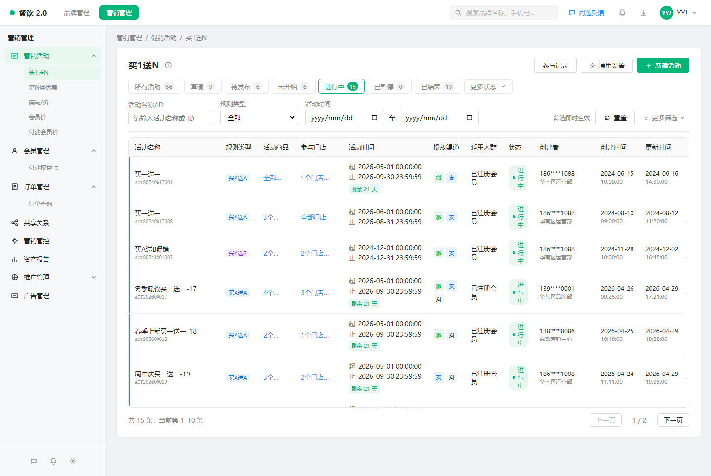

**行操作「暂停活动」**

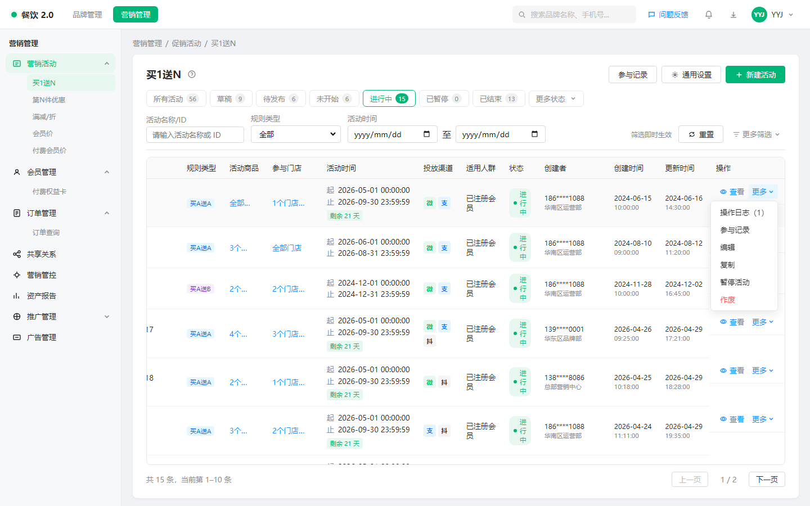

**暂停确认**

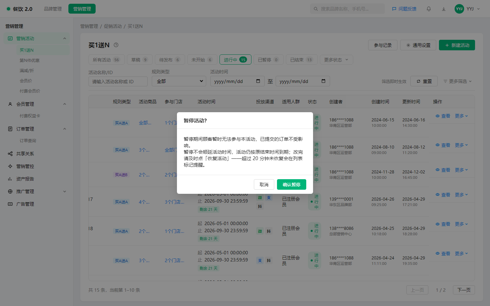

**已暂停列表（含暂停时长提示）**

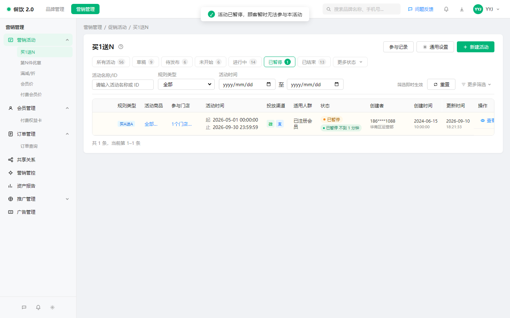

---

### 6.3 已选商品检索

#### 6.3.1 功能描述

在各促销活动类型的新建/编辑流程中，当存在「已选商品」（或部分不参与商品）列表且列表较长时，支持关键词快速查找，并对筛选结果做批量操作。

覆盖范围见 **5.1.1**；无商品范围配置的类型可不展示检索入口。

#### 6.3.2 前置条件

- 用户处于该活动类型新建或编辑向导的商品配置步骤。
- 已选择「部分商品参与」或「部分商品不参与」（或等价配置），且已选列表非空。

#### 6.3.3 入口与触发

| 入口 | 触发条件 | 展示规则 |
|---|---|---|
| 已选商品列表上方检索框 | 已选数量 ≥ 1 | 始终展示；无结果时展示空态 |

#### 6.3.4 主流程

1. 用户在检索框输入关键词（商品名称 / 商品编码 / 商品 ID，忽略大小写与首尾空格）。
2. 列表即时展示命中商品，并显示「筛选出 N 条，共 M 条」。
3. 用户可清除筛选，恢复完整已选列表。
4. 筛选期间：表头全选、批量设置（如会员价批量改价）、批量移除仅作用于当前筛选结果。
5. 分页基于筛选后的结果重新计算。

#### 6.3.5 分支与异常流程

| 场景 | 触发条件 | 系统处理 | 用户反馈 |
|---|---|---|---|
| 无命中 | 关键词无匹配 | 展示空态 | 「未找到匹配商品」+ 清除筛选入口 |
| 筛选中点批量移除 | 已勾选筛选结果 | 仅移除勾选项 | 成功 Toast；未命中商品保留 |
| 反选/不参与列表 | 部分不参与 | 同样支持检索与批量移除 | 文案改为「不参与商品」 |

#### 6.3.6 业务规则

| 规则编号 | 规则说明 | 示例 | 备注 |
|---|---|---|---|
| S-R1 | 检索字段：商品名称、商品编码、商品 ID | 输入「拿铁」命中名称含拿铁的商品 | 与选品弹窗检索口径一致 |
| S-R2 | 检索只过滤「已选列表」，不改变活动真实已选集合，除非用户执行移除/改价 | 输入关键词不会自动删商品 | |
| S-R3 | 筛选态下批量操作作用域 = 当前筛选结果 | 全选筛选结果 3 个后批量移除，只删 3 个 | 必须有作用域提示文案 |
| S-R4 | 清空关键词后恢复完整列表与分页 | — | |
| S-R5 | 5.1.1 清单中凡具备已选商品列表的活动类型均须支持检索，不得仅在部分类型上线 | — | 正式产品验收项 |

#### 6.3.7 页面与交互要求

| 页面/组件 | 展示内容 | 操作 | 交互反馈 |
|---|---|---|---|
| 检索框 | 占位：在已选商品中查找：名称 / 编码 / 商品ID | 输入 | 即时过滤 |
| 计数文案 | 筛选出 N / 共 M | 清除筛选 | 一键清空关键词 |
| 作用域提示 | 批量设置与移除仅对筛选结果生效 | — | 仅筛选态显示 |
| 空态 | 未找到匹配商品 | 清除筛选 | |

#### 6.3.8 文案要求

| 场景 | 类型 | 文案 | 按钮 |
|---|---|---|---|
| 检索占位 | Placeholder | 在已选商品中查找：名称 / 编码 / 商品ID | — |
| 筛选计数 | 辅助文案 | 筛选出 N 条，共 M 条 | 清除筛选 |
| 作用域 | 提示 | 批量设置与移除仅对筛选结果生效 | — |
| 空结果 | 空态 | 未找到匹配商品，请调整关键词或清除筛选 | 清除筛选 |
| 批量移除确认 | 弹窗 | 确认移除已勾选的 N 个商品？ | 取消 / 确认移除 |

#### 6.3.9 验收标准

- Given 已选 100+ 商品，When 输入某商品名称片段，Then 列表仅显示命中项且可定位该商品。
- Given 处于筛选态并勾选全部筛选结果，When 批量移除，Then 仅移除命中项，未命中商品仍在已选中。
- Given 筛选无结果，When 查看列表，Then 展示空态且可清除筛选恢复。
- Given 会员价等支持批量改价的活动，When 筛选后批量改价，Then 仅改筛选结果内的勾选商品。

#### 6.3.10 原型截图

> 原型以会员价「参与商品及优惠」步演示检索；买1送N / 第N件优惠 / 满减/折 / 付费会员价等同理。

**已选商品检索条**

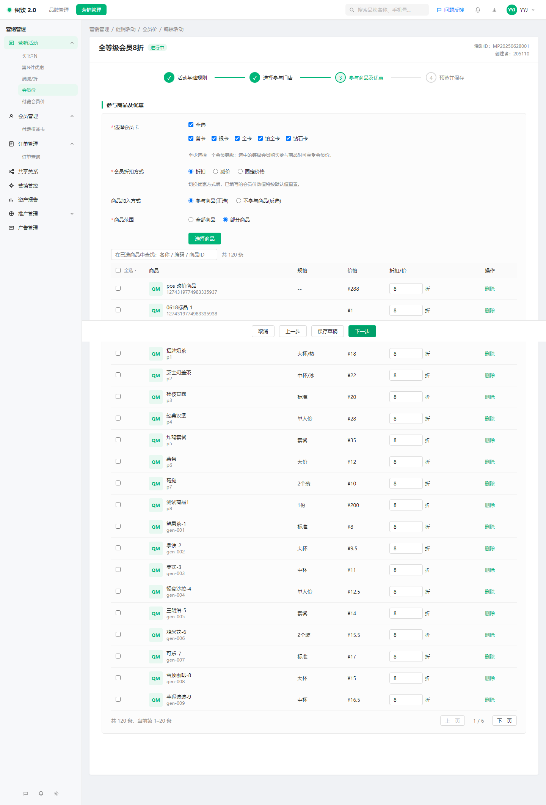

**输入关键词后的筛选结果（含作用域提示）**

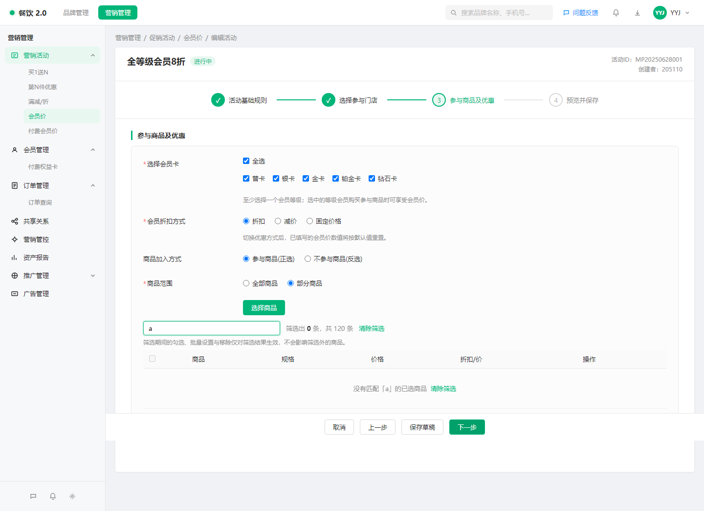

---

### 6.4 活动类型维度的跨活动参与记录

#### 6.4.1 功能描述

在**每一个**促销活动类型下，均支持一次查询多个（或全部）该类型活动的参与记录，按需缩小到指定活动集合，并支持筛选、汇总与**导出**，避免「一个活动进出一次」。

覆盖范围与导出要求见 **5.1.1**：限时折扣、满赠、特惠加购、随机立减、减配送费、企业员工折扣、储值支付优惠、一口价、新客专享、积分抵现、自定义餐盒、超时赔付等当前原型未覆盖的类型，正式产品同样必须支持查询与导出；原型阶段可不补页面，但不能从需求范围中剔除。

明细列可根据活动类型差异化（如买1送N 含赠品形态，满减含优惠档位等），但以下能力必须齐备：类型维度入口、活动多选、筛选、分页、按活动汇总（P1）、**导出**。

#### 6.4.2 前置条件

- 用户具备该活动类型的查看权限。
- 该活动类型已具备可查询的参与事实数据（各类型数据就绪后方可对客开通查询；能力与入口须按统一产品口径建设）。

#### 6.4.3 入口与触发

| 入口 | 触发条件 | 展示规则 |
|---|---|---|
| 各活动类型列表页头部「参与记录」 | 始终可见 | 进入后默认查询该类型下全部活动 |
| 各活动类型列表行操作「参与记录」 | 活动存在 | 进入后默认仅选中该活动，可再扩大范围 |
| 参与记录页「选择活动」 | 进入页面后 | 打开活动多选器 |
| 参与记录页「导出」 | 始终可见 | **全量活动类型均须提供**；按当前筛选结果创建导出任务 |

#### 6.4.4 主流程

1. 用户从列表头部进入「参与记录」，默认活动范围 = 全部活动。
2. 或从某一活动行进入，默认活动范围 = 该活动。
3. 用户点击「选择活动」，按名称/ID/状态筛选并勾选一个或多个活动；不勾选表示全部活动。
4. 用户可继续按订单号/手机号/取餐号、门店、参与时间、赠品形态、支付/退款状态筛选。
5. 用户可在「参与明细」与「按活动汇总」之间切换。
6. 汇总行可「查看明细」，自动将活动范围收敛为该活动并切回明细。
7. 用户点击「导出」，按**当前已应用的筛选结果**创建导出任务。

#### 6.4.5 分支与异常流程

| 场景 | 触发条件 | 系统处理 | 用户反馈 |
|---|---|---|---|
| 所选活动均无记录 | 筛选后为空 | 空态 | 调整活动范围或筛选条件后重试 |
| 重置筛选 | 点重置 | 清空关键字/门店/时间等，**保留当前活动范围** | — |
| 从订单详情返回 | 查看原订单后返回 | 保留进入前的活动范围与筛选 | 不丢上下文 |
| 其他类型暂无明细数据 | 数据未就绪 | 展示空态说明，**仍保留查询与导出入口** | 活动产生参与后将在此展示；导出无数据时提示无可导出记录 |

#### 6.4.6 业务规则

| 规则编号 | 规则说明 | 示例 | 备注 |
|---|---|---|---|
| R-R1 | 查询范围限定在「同一活动类型」内 | 买1送N 页只出买1送N 记录 | 不做跨类型混合 |
| R-R2 | 活动范围：空 = 全部；非空 = 仅这些活动 ID | 勾选 3 个活动只出这 3 个 | |
| R-R3 | 导出范围 = 当前筛选结果，不是「当前页」；**所有活动类型均须支持导出** | 共 1200 条筛选命中则导出这 1200 条 | 大数据量走异步任务；不设「仅部分类型可导出」例外 |
| R-R4 | 明细在多活动范围内需展示「所属活动」 | 名称 + 活动 ID | 单活动范围可隐藏该列 |
| R-R5 | 按活动汇总字段至少包含：参与人次、参与用户数、优惠总额、已退款笔数、最近参与时间 | — | 无优惠额的类型可用等价金额字段或展示「-」 |
| R-R6 | 页头合计至少包含：参与记录数、涉及活动数、参与用户数、优惠总额（或类型等价汇总） | — | |
| R-R7 | 5.1.1 清单中全部活动类型均须具备跨活动参与记录查询与导出，含当前原型未覆盖类型 | — | 正式产品验收项；原型可不演示全部类型 |

#### 6.4.7 页面与交互要求

| 页面/组件 | 展示内容 | 操作 | 交互反馈 |
|---|---|---|---|
| 页头范围 | 全部活动 / 单活动名 / 已选 N 个活动 | 选择活动 | 打开多选弹窗 |
| 活动选择器 | 名称、ID、状态、时间、参与记录条数 | 检索、按状态筛、仅看有记录、全选筛选结果 | 底部显示已选数量与约计记录数 |
| 视图切换 | 参与明细 / 按活动汇总 | 切换 | 分页重置 |
| 明细表 | 原参与记录字段 + 所属活动（多活动时） | 详情 / 赠品快照 / 查看原订单 | 抽屉或弹窗 |
| 导出 | — | 点击导出 | Toast：导出任务已创建（含活动数/记录数） |

#### 6.4.8 文案要求

| 场景 | 类型 | 文案 | 按钮 |
|---|---|---|---|
| 说明条 | Banner | 支持一次查询多个活动的参与记录：先在「活动」里选定范围（不选即全部活动），再按条件筛选；导出按当前筛选结果一次性导出 | — |
| 活动选择器未勾选 | 页脚 | 未勾选活动，按全部活动查询（约 X 条记录） | 确定 |
| 已勾选 | 页脚 | 已选 N 个活动，约 M 条记录 | 清空 / 取消 / 确定 |
| 导出成功 | Toast | 导出任务已创建（N 个活动 / M 条记录），请稍后在下载中心查看 | — |
| 空态 | 空态 | 暂无参与记录 / 调整活动范围或筛选条件后重试 | — |

#### 6.4.9 验收标准

- Given 某类型下存在多个有参与记录的活动，When 从列表头部进入参与记录且不选活动，Then 可看到全部活动的参与明细。
- Given 从活动 A 行进入，When 打开页面，Then 默认仅含活动 A；改为勾选 A+B 后，明细同时包含两者并显示所属活动。
- Given 当前筛选命中 100 条分属 5 个活动，When 导出，Then 导出任务覆盖这 100 条而非单活动或当前页。
- Given 切换到按活动汇总，When 点击某行「查看明细」，Then 活动范围收敛为该活动并展示明细。
- Given 重置筛选，When 完成重置，Then 活动范围保持不变，其他条件清空。
- Given 任意 5.1.1 清单中的活动类型，When 进入该类型参与记录页，Then 可见导出入口；有筛选结果时可成功创建导出任务。
- Given 某活动类型暂无参与数据，When 点击导出，Then 提示无可导出记录，且不静默失败。

#### 6.4.10 原型截图

> 原型以买1送N 参与记录演示；正式产品各活动类型均须具备同等查询与导出能力。

**类型维度入口 · 默认全部活动**

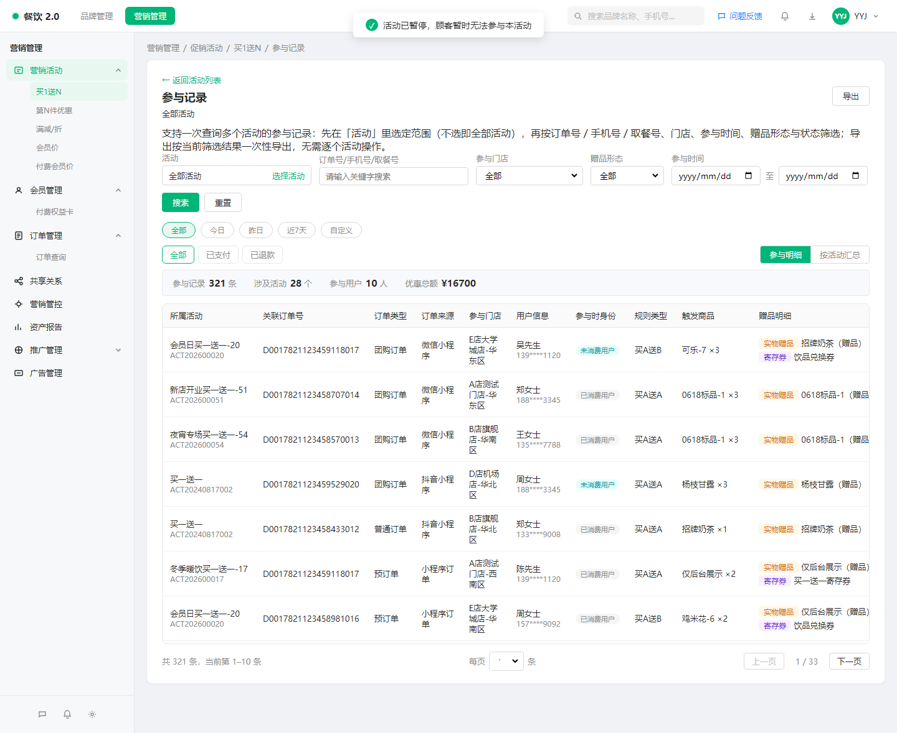

**选择活动弹窗**

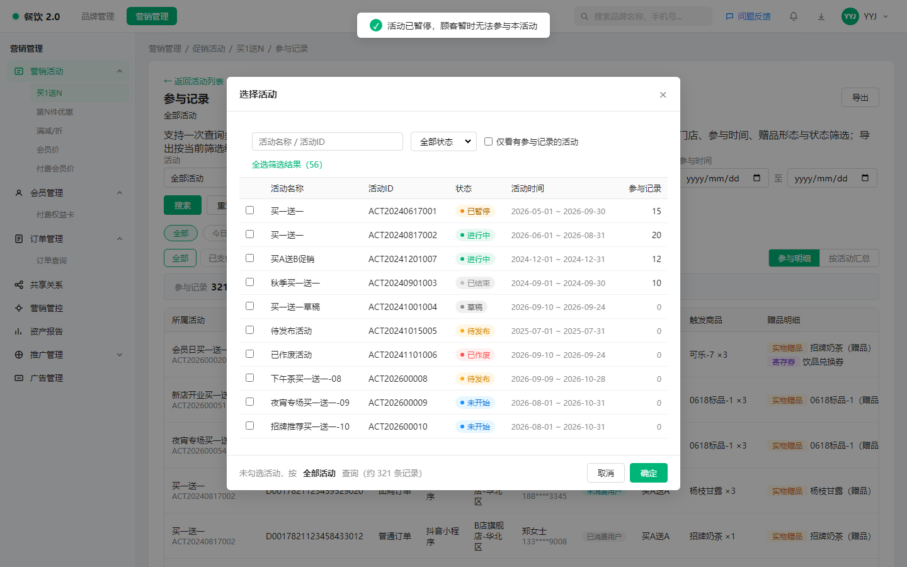

**勾选多个活动**

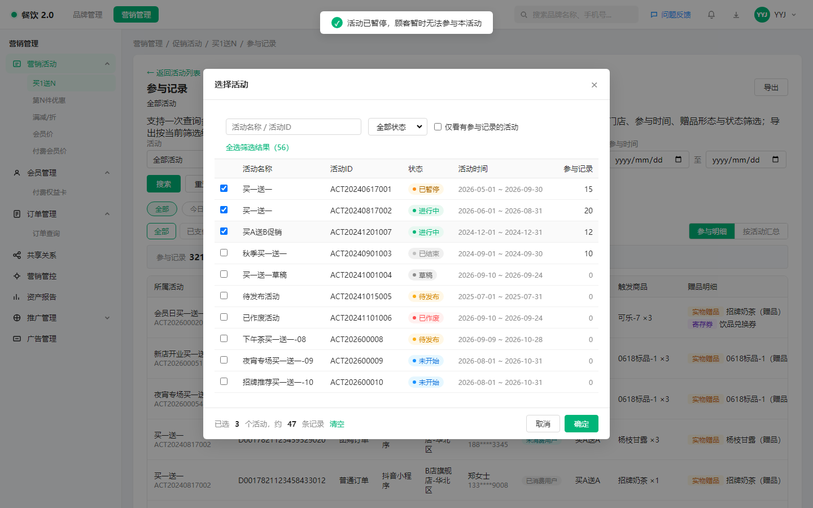

**多活动明细（含所属活动列）**

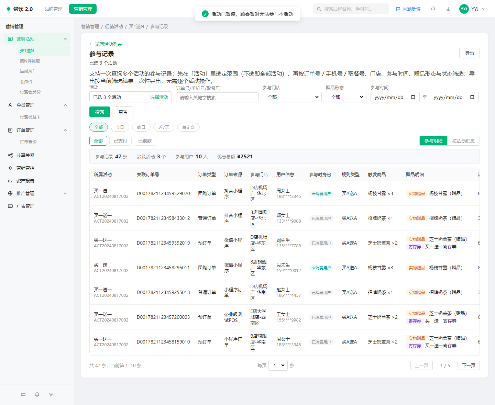

**按活动汇总**

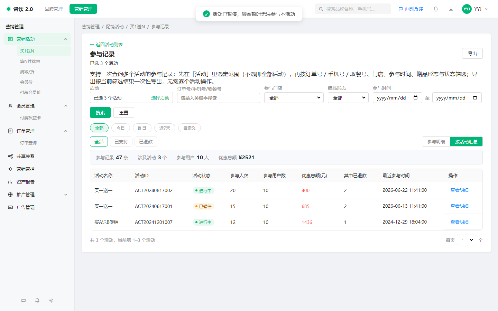

---

### 6.5 付费会员价 · 草稿状态

#### 6.5.1 功能描述

付费会员价活动无固定起止时间，状态跟随关联付费会员卡与运营动作。本期补齐「草稿」状态，使运营可以在旧活动仍生效时预配新活动，支持半成品保存、删除与正式发布。

付费会员价完整状态集合（相对顺序）：全部 → 草稿 → 待发布 → 进行中 → 已暂停 → 已作废（无「未开始 / 已结束」）。

#### 6.5.2 前置条件

- 操作人具备付费会员价活动的新建/编辑权限。
- 新建默认进入草稿；复制活动亦生成草稿（需重新确认关联卡与权益）。

#### 6.5.3 入口与触发

| 入口 | 触发条件 | 展示规则 |
|---|---|---|
| 付费会员价列表 ·「新建活动」 | 始终 | 创建后为草稿 |
| 列表状态 Tab「草稿」 | 始终 | 展示草稿数量 |
| 草稿行操作「编辑 / 发布 / 删除」 | 状态 = 草稿 | 进行中等状态不展示删除 |
| 卡模版权益上的「快捷创建活动」（若已具备） | 选定权益后 | 预填卡与权益，仍先落草稿，可继续编辑后发布 |

#### 6.5.4 主流程

1. 用户新建付费会员价活动，填写至少活动名称后点击「保存草稿」。
2. 系统保存为「草稿」，不对顾客生效，不参与冲突校验。
3. 用户可多次打开草稿继续完善：门店、商品、优惠力度、卡模版与权益绑定等；草稿阶段绑定可更换。
4. 用户点击「发布」：
   - 系统做完整必填与规则校验；
   - 与同一卡模版 + 同一权益下、非草稿且非已作废的活动做门店×商品冲突校验；
   - 通过后：关联卡「在售」→「进行中」；否则 →「待发布」。
5. 典型换挡：旧活动保持进行中 → 新活动草稿配齐 → 作废旧活动（或确保范围不重叠）→ 发布新活动。
6. 不需要的草稿可直接删除，无顾客影响。

#### 6.5.5 分支与异常流程

| 场景 | 触发条件 | 系统处理 | 用户反馈 |
|---|---|---|---|
| 草稿缺活动名称 | 保存草稿 | 拦截 | 请填写活动名称 |
| 发布时配置不完整 | 点发布 | 拦截并指出缺失项 | 按向导步骤提示补齐 |
| 发布时与已有活动冲突 | 同卡+同权益且门店与商品同时重叠 | 拦截发布 | 提示冲突活动及重叠范围 |
| 关联卡上架 | 卡变为在售 | 仅拉起「待发布」活动为进行中 | **不自动发布草稿** |
| 复制活动 | 从已有活动复制 | 生成草稿，清空/要求重选绑定 | 提示需重新关联权益卡 |
| 非草稿点删除 | 待发布/进行中/已暂停/已作废 | 不提供删除 | 已发布用「作废」 |

#### 6.5.6 业务规则

| 规则编号 | 规则说明 | 示例 | 备注 |
|---|---|---|---|
| D-R1 | 草稿不对客生效 | 点单不命中草稿活动 | |
| D-R2 | 保存草稿最低要求：活动名称必填；其余步骤允许半成品 | 可先建名再回头选品 | |
| D-R3 | 草稿不参与冲突校验；已作废不参与；已暂停参与（因其随时可能恢复） | 旧活动进行中时可并存替换草稿 | |
| D-R4 | 发布时才做完整校验 + 冲突校验 | — | |
| D-R5 | 发布目标状态：关联卡在售 → 进行中；否则 → 待发布 | 卡未上架时先待发布 | |
| D-R6 | 卡上架只驱动「待发布 → 进行中」，**不会**自动把草稿变成进行中 | 草稿必须人工发布 | 保留运营控制权 |
| D-R7 | 仅草稿可删除；待发布/进行中/已暂停仅可作废 | — | |
| D-R8 | 草稿阶段可修改卡模版与权益绑定；一旦发布成功，绑定锁定不可更换 | 发错卡只能作废重建 | |
| D-R9 | 同一卡模版 + 同一权益下，允许多个活动并存，只要参与门店 × 参与商品不重叠 | — | 与专项冲突口径一致 |
| D-R10 | 进行中的价格/资格类规则需先暂停再改；草稿无此限制 | — | 展示类字段规则以专项为准 |

#### 6.5.7 页面与交互要求

| 页面/组件 | 展示内容 | 操作 | 交互反馈 |
|---|---|---|---|
| 列表状态 Tab | 含「草稿」 | 筛选 | 计数准确 |
| 草稿行 | 草稿徽标 | 编辑 / 发布 / 删除 | 删除需确认 |
| 向导底部 | 保存草稿 / 发布 | 按校验结果 | 成功 Toast 并回列表或留页 |
| 绑定区 | 卡模版、权益 | 草稿可改；发布后只读 | 锁定时有说明 |

#### 6.5.8 文案要求

| 场景 | 类型 | 文案 | 按钮 |
|---|---|---|---|
| 保存草稿成功 | Toast | 草稿已保存 | — |
| 发布成功（待发布） | Toast | 发布成功，活动待关联会员卡上架后生效 | — |
| 发布成功（进行中） | Toast | 发布成功，活动已生效 | — |
| 删除草稿确认 | 弹窗 | 草稿删除后不可恢复，确认删除？ | 取消 / 确认删除 |
| 绑定已锁定 | 辅助说明 | 活动发布后不可更换关联卡与权益 | — |

#### 6.5.9 验收标准

- Given 新建付费会员价且仅填写活动名称，When 保存草稿，Then 列表出现「草稿」且顾客侧不生效。
- Given 旧活动进行中且门店×商品将重叠，When 保存同卡同权益的新草稿，Then 允许保存（不因冲突拦截）。
- Given 该草稿配置齐全但仍与进行中活动重叠，When 发布，Then 被冲突拦截；作废旧活动或调整范围后可发布成功。
- Given 草稿关联卡不在售，When 发布成功，Then 状态为待发布；卡上架后变为进行中，且其他草稿不被自动发布。
- Given 活动为草稿，When 删除，Then 活动从列表消失；非草稿无删除入口。
- Given 活动仍为草稿，When 更换卡模版或权益，Then 允许保存；发布后再次进入，绑定不可改。

#### 6.5.10 原型截图

**列表状态含「草稿」**

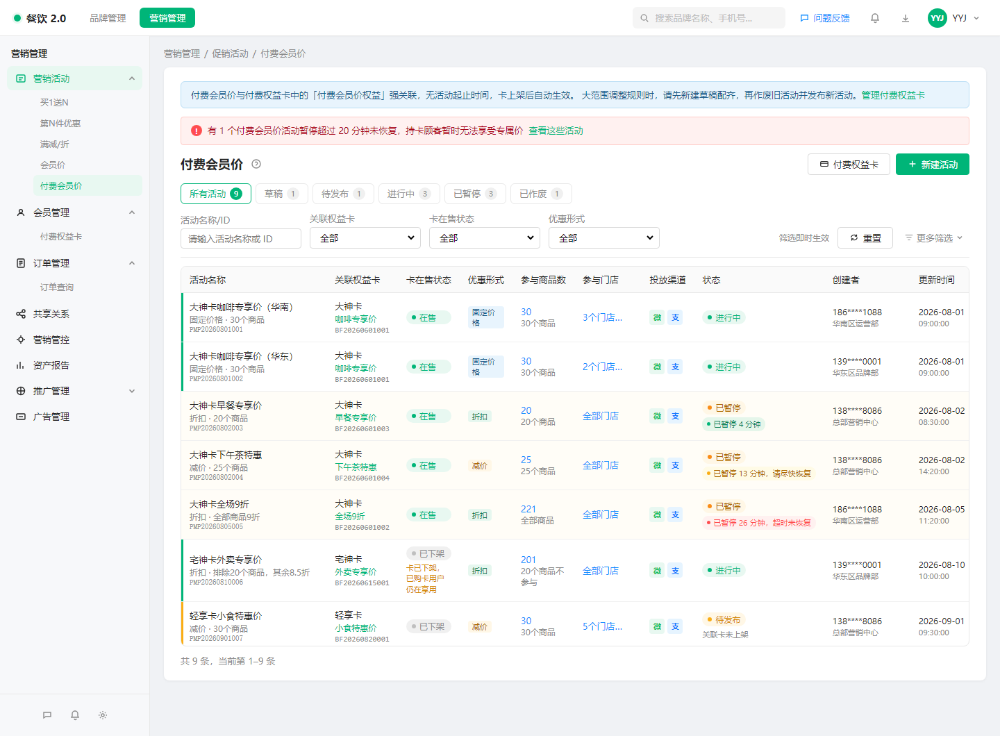

**草稿列表**

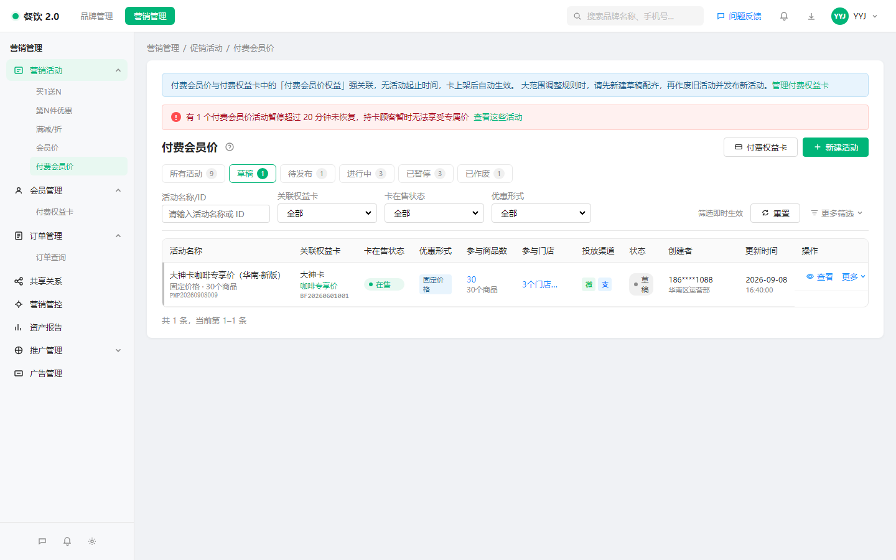

**草稿编辑向导（可保存草稿 / 发布）**

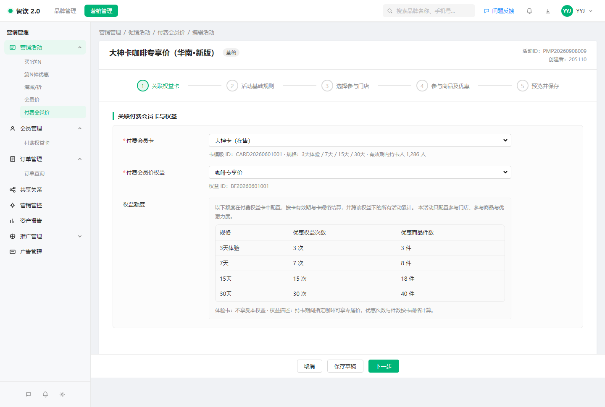

## 七、数据、埋点与实验

### 7.1 数据影响

| 数据对象 | 字段/状态/事件 | 影响类型 | 说明 |
|---|---|---|---|
| 活动（有起止时间） | 状态增加「已暂停」 | 新增状态 | 与原有草稿/待发布/未开始/进行中/已结束/已作废并存 |
| 活动 | 进入暂停时刻 | 新增 | 用于时长计算与超时提醒 |
| 付费会员价活动 | 状态增加「草稿」 | 新增状态 | 与待发布/进行中/已暂停/已作废并存 |
| 参与记录查询 | 活动 ID 集合条件 | 变更 | 由「固定单活动」变为「可选多活动/全部」 |
| 已选商品列表 | — | 无持久化变更 | 检索为纯前端过滤交互 |

### 7.2 埋点需求

| 事件名称 | 触发时机 | 事件属性 | 用途 |
|---|---|---|---|
| activity_pause_confirm | 确认暂停 | 活动类型、活动 ID | 统计暂停使用频次 |
| activity_resume_confirm | 确认恢复 | 活动类型、活动 ID、恢复后状态 | 分析恢复结果分布 |
| selected_product_search | 输入关键词并产生过滤 | 活动类型、是否有命中 | 验证检索价值 |
| participation_query_scope | 确认活动选择 | 活动类型、所选活动数（0=全部） | 评估跨活动查询使用度 |
| participation_export | 点击导出 | 活动类型、活动数、记录数 | 评估导出效率提升 |
| paid_member_price_draft_save | 保存草稿 | 活动 ID、是否已绑卡/权益 | 草稿使用度 |
| paid_member_price_publish | 发布草稿 | 活动 ID、发布后状态 | 换挡成功率 |

### 7.3 实验设计（可选）

本期不做 A/B 实验，全量对具备权限的运营账号开放。

## 八、非功能需求

### 8.1 性能要求

- 已选商品检索：本地列表过滤应在输入后即时反馈（目标 ≤ 300ms 感知延迟；超大列表以分页 + 过滤结果集为准）。
- 跨活动参与记录：默认分页加载；导出走异步任务，避免页面长时间阻塞。
- 暂停到期扫描：进入列表或定时检查时，及时把「暂停中已到期」转为已结束。

### 8.2 兼容性要求

- 存量进行中/已结束活动：无暂停记录时表现与现网一致。
- 历史参与记录：单活动入口行为兼容；新增全量入口不破坏原行内入口。
- 后台浏览器：与现有促销后台一致（Chrome 近两个正式版）。

### 8.3 安全、隐私与合规

- 参与记录中的手机号继续脱敏展示。
- 暂停/恢复/导出需校验操作人权限，与活动编辑/查看权限对齐。
- 导出文件权限与现有导出任务一致，不得扩大可见范围。

### 8.4 降级与容错

- 导出任务创建失败：Toast 明确失败，可重试。
- 参与记录查询超时：保留已填筛选条件，提示重试。
- 暂停/恢复并发：以后端最终状态为准，前端刷新列表。

## 九、依赖、风险与开放问题

### 9.1 外部依赖

| 依赖项 | 负责人 | 交付时间 | 风险 |
|---|---|---|---|
| 消费者端/优惠计算：识别「已暂停」不命中该活动 | 相关研发 | TBD | 若不同步，后台暂停但顾客仍享优惠 |
| 第N件优惠/满减等及原型外活动类型的参与事实数据与明细字段 | 数据/研发 | TBD | 影响各类型上线节奏，但不改变「必须支持」的产品范围 |
| 导出/下载中心既有能力 | 平台 | 已有 | 需透传活动类型、活动数与记录数；全量类型共用 |

### 9.2 风险评估

| 风险 | 影响 | 概率 | 应对方案 |
|---|---|---|---|
| 暂停后忘记恢复 | 活动长期不对客 | 中 | 时长分级提醒 + 列表顶栏超时汇总 |
| 筛选态批量移除被误解为全量移除 | 误删大量商品 | 中 | 强制作用域提示 + 确认弹窗展示数量 |
| 全量参与记录导出量过大 | 任务失败/超时 | 中 | 异步导出；引导先缩小活动范围或时间；可提示预估条数 |
| 各活动类型参与字段不一致 | 统一表格难落地 | 中 | 公共列 + 类型扩展列；能力（查询/导出）必须齐，列可差异 |
| 原型外活动类型漏排期 | 正式环境能力缺口 | 中 | 以 5.1.1 清单作为研发/测试验收清单，按类型分期交付但范围不砍 |

### 9.3 开放问题

| 编号 | 问题 | 负责人 | 截止时间 | 状态 |
|---|---|---|---|---|
| 1 | 跨活动参与记录是否全量活动类型同版本上明细？ | 产品 | 2026-09-10 | **已确认**：全部促销活动类型都必须支持（含查询与导出）；可按类型分期交付，但需求范围不剔除；原型外类型见 5.1.1 |
| 2 | 暂停操作是否需要独立「操作日志」页，还是复用现有活动日志即可？ | 产品 | TBD | 待确认 |
| 3 | 跨活动导出是否需要上限（如单次最多 N 个活动或 M 条记录）？ | 产品 | 2026-09-10 | **已确认**：所有活动类型均须支持导出；不因类型设例外。单次条数/活动数上限若工程需要可另定技术阈值，不作为「部分类型不支持导出」的产品例外 |
| 4 | 付费会员价草稿是否允许长期滞留（如超过 N 天未发布的提醒/清理）？ | 产品 | TBD | 待确认 |

## 十、上线计划

### 10.1 里程碑

| 阶段 | 时间 | 交付物 | 负责人 |
|---|---|---|---|
| 需求评审 | TBD | PRD 定稿 | 产品 |
| 设计评审 | TBD | 列表/弹窗/参与记录交互稿 | 设计 |
| 研发联调 | TBD | 按 5.1.1 清单分类型交付；消费者不命中已暂停活动 | 研发 |
| 测试验收 | TBD | 按第六章 + 5.1.1 全量类型清单验收（含导出） | 测试 |
| 全量上线 | TBD | 正式环境 | 研发 |

### 10.2 发布策略

- 是否灰度：建议先灰度 1～2 个品牌验证暂停对客生效、参与记录导出与付费会员价草稿换挡。
- 是否需要开关：建议按活动类型配置能力开关（尤其参与记录）。
- 是否可回滚：可回滚前端入口；已产生的「已暂停」「付费会员价草稿」状态需有兼容展示方案。

### 10.3 上线后监控

- 暂停超时未恢复数量
- 参与记录跨活动查询与导出成功率
- 客诉：暂停期间仍享受到已暂停活动优惠（应为 0）

## 十一、附录

### 11.1 名词解释

| 名词 | 解释 |
|---|---|
| 已暂停 | 活动仍在配置侧保留，但对顾客临时不生效的状态 |
| 活动范围 | 参与记录查询所覆盖的活动 ID 集合；空表示该类型下全部活动 |
| 已选商品检索 | 仅在已选列表内过滤展示，不等于重新选品 |
| 按活动汇总 | 以活动为行，聚合参与人次、用户数、优惠额等，便于先看量再下钻 |
| 付费会员价草稿 | 已创建但未发布的付费会员价活动；可半成品保存，不对客生效，不参与冲突 |
| 待发布（付费会员价） | 已发布但关联卡尚未在售，等待卡上架后自动进入进行中 |

### 11.2 状态机

**有起止时间的活动 · 与暂停相关片段**

```text
进行中 --暂停--> 已暂停 --恢复（未到期）--> 进行中
已暂停 --到达结束时间--> 已结束
已暂停 --恢复（已到期）--> 已结束
```

说明：暂停不改变活动配置的开始/结束时间；「未开始」不会因为暂停产生（仅进行中可进入暂停）。

**付费会员价 · 与草稿相关片段**

```text
（新建/复制）--> 草稿 --发布（卡在售）--> 进行中
草稿 --发布（卡未在售）--> 待发布 --卡上架--> 进行中
草稿 --删除--> （移除）
待发布 / 进行中 / 已暂停 --作废--> 已作废
进行中 --暂停--> 已暂停 --恢复--> 进行中
```

说明：卡上架不会自动发布草稿；草稿必须由运营主动发布。

### 11.3 参考资料

- 商家端原型：https://promo.yangyaojun-demo.cn/
- 相关原型能力：活动列表暂停/恢复、向导已选商品检索、买1送N 参与记录多活动查询与导出、付费会员价草稿
- 正式产品活动类型清单：见本文 5.1.1（含限时折扣、满赠、特惠加购、随机立减、减配送费、企业员工折扣、储值支付优惠、一口价、新客专享、积分抵现、自定义餐盒、超时赔付等）

### 11.4 原型截图索引

截图目录：`docs/prd/assets/ops-efficiency/`（本地原型 http://127.0.0.1:5180/ 采集）

| 编号 | 文件 | 对应能力 | 说明 |
|---|---|---|---|
| 01 | `01-bogo-list-pause-tab.png` | 暂停/恢复 | 状态 Tab 含「已暂停」 |
| 02 | `02-bogo-row-menu-pause.png` | 暂停/恢复 | 行「更多」含暂停活动 |
| 03 | `03-bogo-pause-confirm.png` | 暂停/恢复 | 暂停确认弹窗 |
| 04 | `04-bogo-paused-list.png` | 暂停/恢复 | 已暂停列表与时长提示 |
| 05 | `05-participation-all.png` | 跨活动参与记录 | 默认全部活动 + 导出 |
| 06 | `06-participation-picker.png` | 跨活动参与记录 | 选择活动弹窗 |
| 07 | `07-participation-picker-selected.png` | 跨活动参与记录 | 多选活动 |
| 08 | `08-participation-multi-detail.png` | 跨活动参与记录 | 多活动明细 |
| 09 | `09-participation-by-activity.png` | 跨活动参与记录 | 按活动汇总 |
| 10 | `10-selected-product-search-bar.png` | 已选商品检索 | 检索条 |
| 11 | `11-selected-product-filtered.png` | 已选商品检索 | 关键词筛选结果 |
| 12 | `12-paid-member-list-draft-tab.png` | 付费会员价草稿 | 列表含草稿 Tab |
| 13 | `13-paid-member-draft-list.png` | 付费会员价草稿 | 草稿列表 |
| 14 | `14-paid-member-draft-wizard.png` | 付费会员价草稿 | 草稿编辑向导 |
