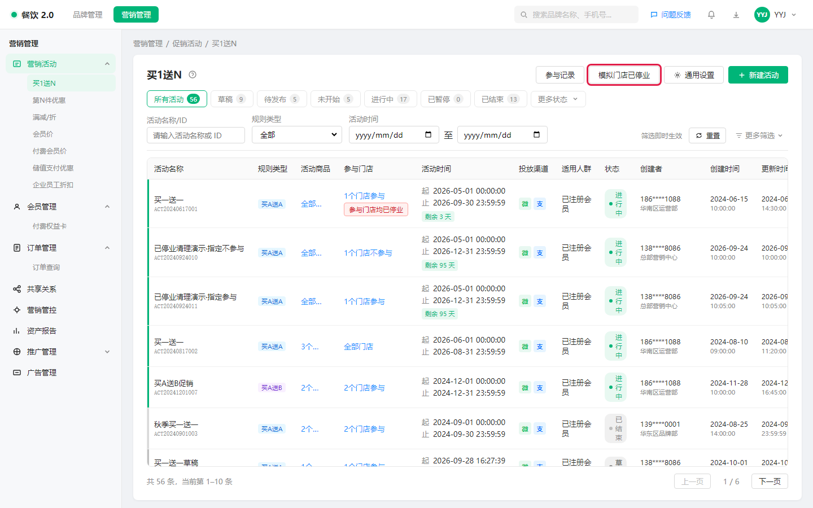
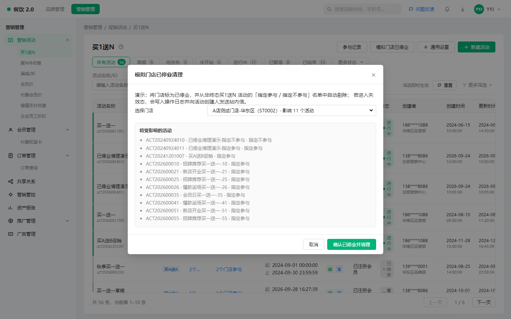
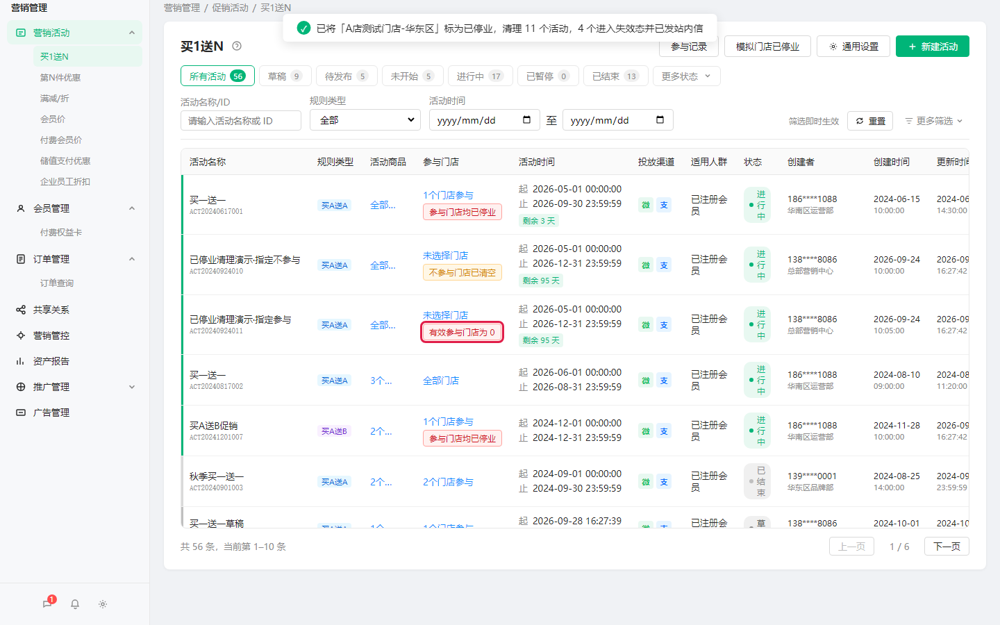
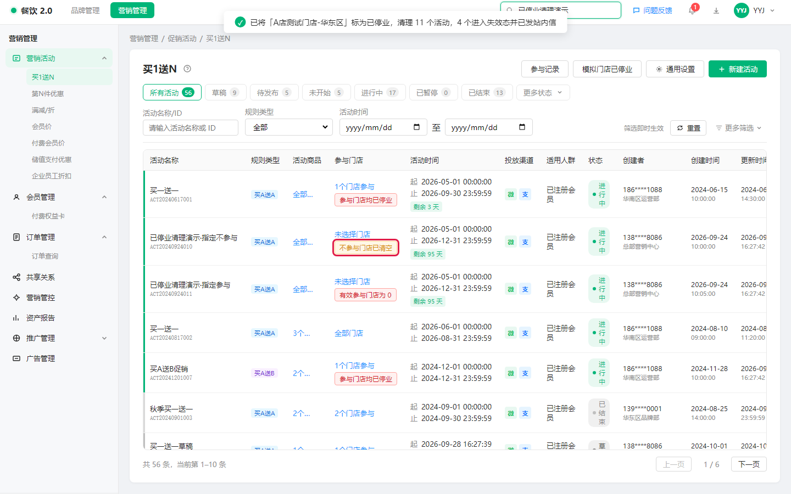
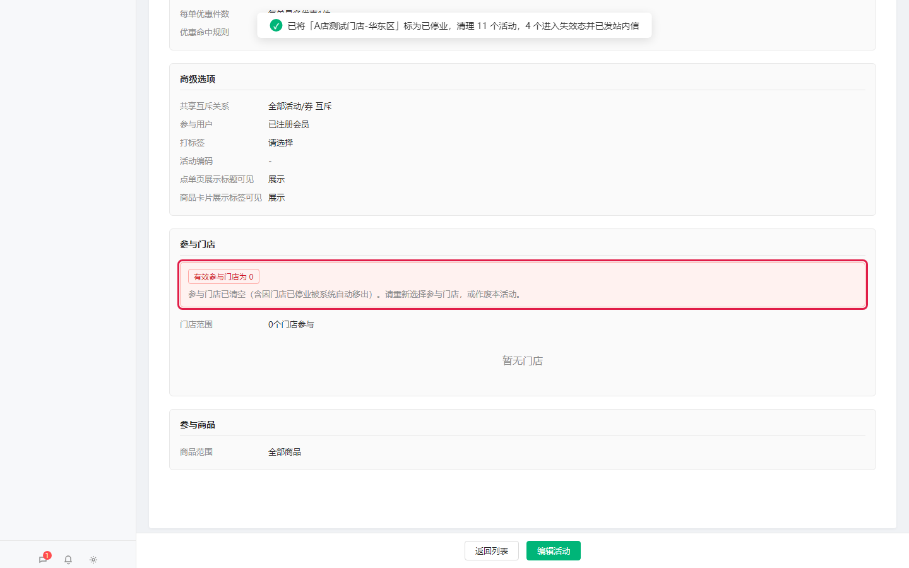
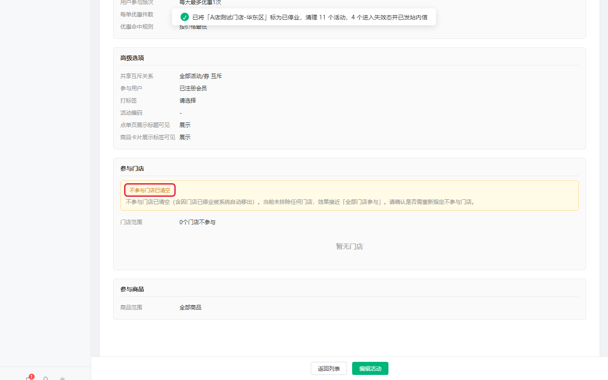
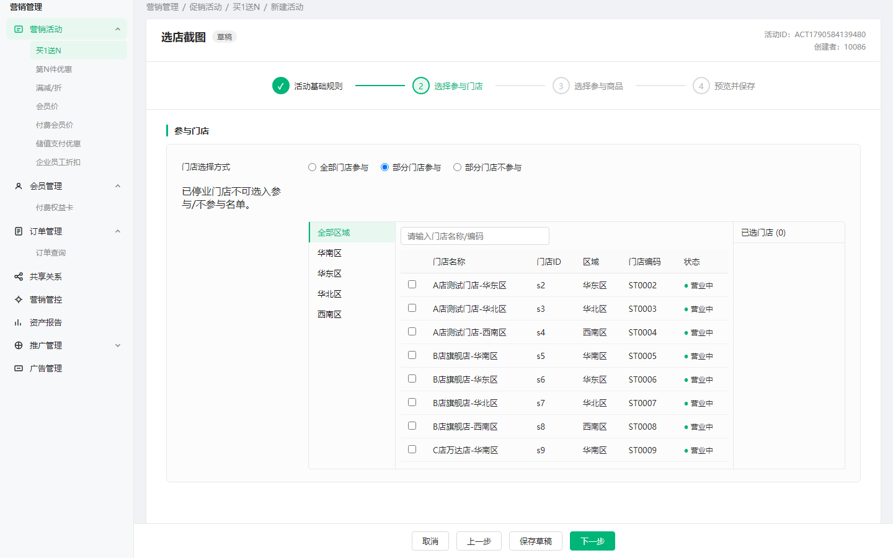
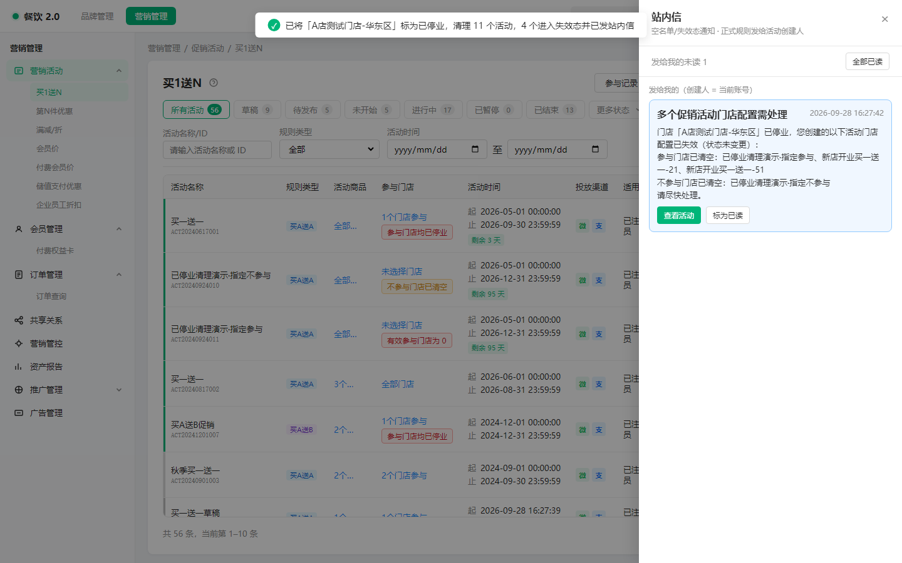

# 【PRD】门店已停业后自动剔除促销活动门店

## 一、文档信息

| 字段 | 内容 |
|---|---|
| 文档状态 | 草稿（待评审） |
| 版本号 | v1.6 |
| 作者 | 产品 |
| 创建时间 | 2026-09-24 |
| 最近更新 | 2026-09-28 |
| 目标上线时间 | TBD |
| 相关团队 | 产品 / 设计 / 研发 / 测试 / 运营 |
| 相关链接 | 工单 GD260427136；活动类型清单对齐《促销活动运营效率优化》PRD 中的促销活动类型表 |
| 原型截图目录 | `docs/prd/assets/store-closure/`（商家端买1送N Demo 采集） |
| 演示说明 | 商家端 Demo 可在买1送N 轻量演示「模拟已停业清理 / 失效提示 / 站内信」，正式能力仍须覆盖全部适用活动类型 |

## 二、变更日志

| 时间 | 版本号 | 变更人 | 主要变更内容 | 同步状态 |
|---|---|---|---|---|
| 2026-09-24 | v1.0～v1.3 | 产品 | 定稿业务口径：已停业触发；指定参与 + 指定不参与均剔除；失效提示 + 创建人站内信；上线一次性补清；覆盖全量适用活动类型 | 待评审 |
| 2026-09-28 | v1.4 | 产品 | 按产品经理视角重写：去掉偏实现表述，统一为「用户看到什么、能做什么、系统如何判断」 | 待评审 |
| 2026-09-28 | v1.5 | 产品 | 补充商家端原型页面截图（模拟清理 / 列表失效标识 / 详情说明 / 站内信 / 选店限制） | 待评审 |
| 2026-09-28 | v1.6 | 产品 | 确认：参与清空 / 不参与清空统一自动「已暂停」，商家处理路径一致（修门店 → 恢复） | 待评审 |

## 三、背景与问题定义

### 3.1 背景说明

促销后台用于配置和管理各类促销活动。活动门店范围常见三种：

- **全部门店参与**
- **部分门店参与**（指定参与名单）
- **部分门店不参与**（指定不参与名单）

门店是否继续营业，以门店主数据为准。本需求中，**「永久闭店」与后台展示的「已停业」为同一业务含义**。门店变为已停业后，不应再作为可配置、可参与促销的有效门店。

但历史已保存的活动里，指定参与 / 指定不参与名单仍可能残留该门店：

- **指定参与残留**：占用活动门店范围，容易在新建 / 编辑 / 复制时误报「活动有冲突」，甚至迫使运营整场作废重建（见工单 GD260427136）。
- **指定不参与残留**：排除已停业门店没有业务意义；若名单里全是已停业，排除配置实际失效，运营往往无感知。

### 3.2 问题陈述

> 当前品牌运营在门店变为已停业后，未结束的促销活动仍可能保留该门店在「指定参与 / 指定不参与」名单中：参与侧带来冲突与重建成本，不参与侧带来「排除名单已失效」却无人知晓，缺少自动清理与主动通知。

### 3.3 为什么现在做

- 依赖人工逐活动删门店，成本高、易漏，已有工单反馈。
- 冲突误报会阻断正常新建 / 编辑 / 复制。
- 指定不参与名单「全是已停业」时配置已无意义，需要页面提示并触达活动创建人。

### 3.4 目标用户与场景

| 用户/角色 | 场景 | 痛点 | 期望结果 |
|---|---|---|---|
| 活动创建人 / 品牌运营 | 门店已停业后维护未结束活动 | 要逐个活动删门店，易漏 | 系统自动从参与 / 不参与名单去掉该店 |
| 活动创建人 | 参与名单被剔空，或不参与名单被剔空 | 不知道门店配置已失效 | 列表 / 详情有统一提示，并收到站内信 |
| 活动创建人 | 已停业后复制 / 编辑 / 新建活动 | 被误报「活动有冲突」 | 已停业门店不再占用有效参与范围 |
| 测试 / 运营支持 | 核对清理结果 | 不知哪些活动被改过 | 操作日志可追溯 |

## 四、目标与成功指标

### 4.1 产品目标

- 门店变为**已停业**后，系统自动从**全部未彻底结束**促销活动的「**指定参与**」与「**指定不参与**」名单中移除该门店。
- 能力覆盖正式产品中**全部适用的促销活动类型**（见 5.1.1）。
- 避免因已停业门店残留导致的活动冲突与整场作废重建。
- 当门店配置进入失效情形（参与门店已清空 / 不参与门店已清空）：**统一自动变为「已暂停」**（原因：门店配置失效）；全类型统一前端提示；向**活动创建人**发站内信；商家按同一路径处理：修好门店配置后恢复活动。
- 选店时：已停业门店不可被选入参与 / 不参与名单。
- 上线时完成历史残留一次性补清。

### 4.2 非目标

- 不改写「全部门店参与」活动的已保存配置（已停业门店本身不再进入有效门店集合）。
- 不对**已结束、已作废**等已彻底结束的活动回改门店名单。
- 不因剔除门店而自动**作废**或自动**结束**活动；但进入「参与清空 / 不参与清空」时，**会自动暂停**（与手动暂停可区分原因文案）。
- 门店重新营业后，不自动把门店加回原活动。
- 不回溯修改历史订单、历史参与记录。
- 不改造消费者端优惠展示文案。
- 不新建独立「闭店清理任务中心」或品牌汇总报表（可后续迭代）。

### 4.3 成功指标

| 指标 | 当前值 | 目标值 | 统计口径 | 观测周期 |
|---|---|---|---|---|
| 已停业门店仍残留在未彻底结束活动指定参与 / 不参与名单中的比例 | 依赖人工，易残留 | 自动清理后为 0 | 抽检 / 对账 | 上线验收 + 上线后 2 周 |
| 因已停业残留导致的「活动有冲突」工单 | 有（如 GD260427136） | 明显下降 | 工单 / 运营反馈 | 上线后 4 周 |
| 失效情形创建人触达率 | 无 | 进入失效后创建人可收到站内信，列表可见标识 | 站内信发送成功 + 列表抽检 | 上线验收 |
| 自动剔除可追溯率 | 无统一日志 | 每次成功剔除均可在操作日志查到 | 抽检操作日志 | 上线验收 |

## 五、范围与方案概述

### 5.1 本期范围

| 范围类型 | 内容 |
|---|---|
| 本期做 | ① 已停业后，全量适用类型、未彻底结束活动的指定参与 + 指定不参与名单自动剔除；② 参与清空 / 不参与清空**统一自动暂停**；③ 失效情形统一前端提示；④ 操作日志；⑤ 向活动创建人发站内信；⑥ 选店不可选已停业；⑦ 上线一次性补清 |
| 本期不做 | 改写「全部门店」配置（不参与清空时也不自动改成全部门店）；已彻底结束活动回改名单；自动作废 / 自动结束；重新营业自动加回；历史单据回溯；独立清理中心 / 报表 |
| 最小闭环 | 已停业 → 名单剔除 → 若清空则自动暂停 → 日志 → 失效提示 + 创建人站内信 → 商家修门店后恢复；选店过滤已停业；上线补清 |
| 后续可做 | 按品牌汇总清理报表 |

#### 5.1.1 必须支持的活动类型

> 与《促销活动运营效率优化》中的促销活动类型表对齐。凡支持「部分门店参与 / 部分门店不参与」的类型均须支持。  
> 若某类型本身无门店名单配置，验收时标注「不适用」，不得默认为可选遗漏。

| 活动类型 | 自动剔除要求 | 说明 |
|---|---|---|
| 买1送N | 必须 | Demo 可优先演示 |
| 第N件优惠 | 必须 | |
| 满减/折 | 必须 | |
| 会员价 | 必须 | |
| 付费会员价 | 必须 | 冲突场景受益更明显 |
| 限时折扣 | 必须 | |
| 满赠 | 必须 | |
| 特惠加购 | 必须 | |
| 随机立减 | 必须 | |
| 减配送费 | 必须（适用时） | 有门店名单配置则必须 |
| 企业员工折扣 | 必须 | |
| 储值支付优惠 | 必须 | |
| 一口价 | 必须 | |
| 新客专享 | 必须 | |
| 积分抵现 | 必须（适用时） | |
| 自定义餐盒 | 必须（适用时） | |
| 超时赔付 | 必须（适用时） | |

### 5.2 方案概述

门店变为**已停业**后，促销侧按品牌检查全部适用活动类型中**尚未彻底结束**的活动：

- 若是**指定参与**且名单含该店 → 从参与名单去掉；
- 若是**指定不参与**且名单含该店 → 从不参与名单去掉；
- 留下可追溯的系统操作记录。

「全部门店参与」不改活动已保存的配置。已彻底结束的活动不改门店名单。

清理后若进入失效情形（两类**同一套处理**，降低商家学习成本）：

- **参与门店已清空**：指定参与且有效参与门店为 0 → **自动变为「已暂停」** + 列表 / 详情统一提示 + 创建人站内信。
- **不参与门店已清空**：指定不参与且不参与名单为空 → **同样自动变为「已暂停」** + 统一提示 + 创建人站内信；**不**自动改成「全部门店」模式（避免系统静默扩大范围）。
- **商家处理路径统一**：看到已暂停 → 打开活动看清原因 → 重新配置门店（参与侧补选营业门店；不参与侧重配排除名单或改为全部门店）→ **恢复活动**。
- **上游**：已暂停活动不参与冲突、不参与优惠生效，避免空名单导致服务报错。

上线须对历史已停业残留做一次性补清，判断规则与日常一致（补清导致清空的，同样自动暂停并通知）。

### 5.3 主流程

1. 门店在主数据中变为**已停业**。
2. 系统开始促销侧清理。
3. 找到：未彻底结束、且（指定参与或指定不参与）名单含该店的活动。
4. 从对应名单去掉该店，并写入操作日志。
5. 若进入「参与门店已清空」或「不参与门店已清空」：活动**自动暂停**；展示统一前端标识；向活动创建人发站内信。
6. 创建人通过站内信或列表进入活动，按同一流程处理：修好门店配置后**恢复活动**；也可自行作废。
7. 已暂停及已停业门店均不进入有效参与 / 冲突计算，上游不再因空名单报错。

### 5.4 关键假设

| 假设 | 如何验证 | 若不成立的影响 |
|---|---|---|
| 「已停业」即原需求所述永久闭店，与选店展示一致 | 与门店主数据确认 | 误剔或漏剔 |
| 门店主数据侧已不再把已停业门店提供给选店 | 联调确认 | 选店仍可能看到已停业，促销侧须禁止勾选兜底 |
| 各活动类型对「已彻底结束」的状态定义清晰 | 状态清单对齐 | 漏剔或误剔 |
| 冲突判断使用清理后的有效参与门店 | 规则评审 | 清名单后仍可能误报冲突 |

## 六、详细需求说明

### 6.1 功能清单

| 功能模块 | 功能点 | 优先级 | 用户价值 |
|---|---|---|---|
| 自动剔除 | 已停业后从未彻底结束活动的指定参与 / 指定不参与名单移除该店 | P0 | 免人工清理 |
| 处理边界 | 已彻底结束的活动不处理；其余未彻底结束状态均处理 | P0 | 边界清晰 |
| 失效自动暂停 | 参与清空 / 不参与清空：统一自动「已暂停」 | P0 | 止血 + 路径一致 |
| 失效提示与通知 | 统一 UI + 创建人站内信（文案区分两类清空原因） | P0 | 触达商家 |
| 存量兜底 | 不参与名单非空但全是已停业（补清前）须可识别，并在补清后收敛 | P0 | 存量闭环 |
| 操作日志 | 记录自动移出及原因 | P0 | 可追溯 |
| 选店限制 | 已停业不可选入参与 / 不参与名单 | P0 | 防止再次配入 |
| 上线一次性补清 | 清历史残留（参与 + 不参与） | P0 | 存量闭环 |

### 6.2 自动剔除（核心）

#### 6.2.1 功能描述

门店变为已停业后，系统自动将其从所有未彻底结束的促销活动「指定参与」「指定不参与」名单中移除。

#### 6.2.2 前置条件

- 门店状态已成功变为**已停业**。
- 存在至少一个未彻底结束、且指定参与或不参与名单包含该门店的促销活动。

#### 6.2.3 如何触发

| 触发方式 | 条件 | 用户侧如何感知 |
|---|---|---|
| 系统自动 | 门店变为已停业 | 无需确认；通过操作日志、失效提示、站内信可见结果 |
| 上线补清 | 功能上线时执行一次 | 同日常规则；可能批量产生提示与站内信 |

> 本期无「手动一键清理」独立入口。上线**必须**做一次性补清（见第十章）。

#### 页面示意（商家端原型）

> 以下截图来自买1送N Demo，用于说明正式产品中运营可见的关键界面；正式能力须覆盖全部适用活动类型。

**列表入口 · 模拟已停业清理（Demo）：**

**确认清理弹窗 · 选择门店与受影响活动预览：**

#### 6.2.4 主流程

1. 门店变为已停业。
2. 确定处理范围：该品牌、5.1.1 全部适用活动类型、未彻底结束的活动。
3. 若「指定参与」含该店 → 从参与名单移除。
4. 若「指定不参与」含该店 → 从不参与名单移除。
5. 写操作日志（写清门店名称 / 编码，以及移出的是参与还是不参与名单）。
6. 判断是否进入失效情形；若是 → 前端标识 + 向创建人发站内信。
7. 清理完成；该店不再作为有效参与门店享惠，也不再参与冲突判断。

#### 6.2.5 分支与异常

| 场景 | 系统如何处理 | 用户看到什么 |
|---|---|---|
| 活动已结束 / 已作废等已彻底结束 | 不改名单 | 无变化 |
| 全部门店参与 | 不改活动已保存配置 | 无变化（已停业门店本身不再有效） |
| 指定参与含该店，剔除后仍有营业门店 | 更新名单 + 日志 | 参与门店数减少 |
| 指定参与剔除后为空 | **自动已暂停**；展示「参与门店已清空」；发站内信 | 见 6.4～6.7 |
| 指定不参与含该店，剔除后仍有其他店 | 更新名单 + 日志 | 不参与门店数减少 |
| 指定不参与剔除后为空 | **自动已暂停**；不自动改门店模式；展示「不参与门店已清空」；发站内信 | 见 6.4～6.7 |
| 存量：不参与名单非空但全是已停业 | 补清前可展示「不参与门店均已停业」；补清时应剔光并收敛为「不参与门店已清空」 | 见 6.6 |
| 名单本来就不含该店 | 跳过 | 无打扰 |
| 同一门店重复触发清理 | 若名单中已无该店，不再处理、不重复发信打扰 | 无重复刷屏 |
| 门店重新营业 | **不**自动加回原名单 | 需运营重新配置 |
| 运营正在编辑并保存 | 以清理后的名单为准；保存时不得再把已停业门店写进名单 | 见 R12 |
| 活动类型本身无门店名单 | 标注不适用 | 验收清单写出 |

#### 6.2.6 业务规则

| 编号 | 规则说明 | 示例 / 备注 |
|---|---|---|
| R1 | 门店状态变为**已停业**时触发（与「永久闭店」同一含义） | 选店展示为「已停业」 |
| R2 | 处理范围 = 5.1.1 全部适用促销活动类型 | 正式验收不以 Demo 是否演示为准 |
| R3 | 已彻底结束的活动不处理：有「已结束」则跳过已结束 + 已作废；没有「已结束」的类型则至少跳过已作废 | 如付费会员价：除已作废外都要处理 |
| R4 | 草稿 / 待发布 / 未开始 / 进行中 / 已暂停等未彻底结束状态均处理 | |
| R5 | 指定参与名单含该店 → 移除 | |
| R5a | 指定不参与名单含该店 → 移除 | |
| R6 | 全部门店参与：不改活动已保存配置 | 已停业门店不再进入有效集合 |
| R8 | 进入「参与门店已清空」或「不参与门店已清空」时：**自动变为「已暂停」**；不自动作废、不自动结束 | 两类同一机制 |
| R8a | 暂停原因须可区分：如「门店配置失效（参与门店已清空）」/「门店配置失效（不参与门店已清空）」 | 列表/详情/日志可见 |
| R8b | 已是「已暂停」且因本需求再次命中清空：保持已暂停，不重复刷无效状态变更；站内信按去重规则 | |
| R8c | 无「已暂停」状态的活动类型：采用该类型约定的等价「不可对外生效」状态；验收清单单独标注 | 避免漏类型 |
| R9 | 进入失效情形：统一前端提示 + 向**活动创建人**发站内信 | 见 6.4～6.6 |
| R9a | 站内信只发给创建人；创建人账号不可用时记录失败并可监控，不改发给其他人 | |
| R10 | 每次成功移除都写系统操作日志，并区分参与 / 不参与 | |
| R11 | 已停业门店不得计入有效参与门店（冲突判断、优惠生效均不含） | |
| R12 | 选店不可选已停业；异常提交若仍含已停业门店，不得保存成功 | 防止再次配入 |
| R13 | 重新营业不自动加回 | |
| R14 | 不回溯历史订单 / 参与记录 | |
| R15 | 「参与门店已清空」：恢复 / 发布前须至少配置 1 家营业中参与门店 | |
| R15a | 「不参与门店已清空」：恢复前须完成其一——重新指定至少 1 家不参与门店，或改为「全部门店参与」/「部分门店参与」并配好名单；**系统不自动改模式** | 与参与清空共用「暂停 → 修配置 → 恢复」路径 |
| R15b | 商家处理路径统一：失效自动暂停 → 看清原因标签 → 编辑门店 → 恢复活动 | 降低学习成本 |
| R16 | 冲突判断使用清理后的有效参与门店 | |
| R17 | 上线一次性补清：已停业仍残留在未彻底结束活动参与或不参与名单中的，按日常规则清理 | 含失效提示与站内信 |

#### 清理完成后的列表标识（商家端原型）

清理完成后，活动列表「参与门店」列展示失效标签；顶部可出现结果提示：

**不参与门店已清空（局部）：**

#### 6.2.7 页面与交互

| 页面 / 场景 | 展示什么 | 用户能做什么 | 反馈要求 |
|---|---|---|---|
| 各活动类型列表 | 门店摘要；失效标签（参与已清空 / 不参与已清空 / 补清前「均已停业」） | 进入详情或编辑（按原权限） | 全类型视觉体系统一，可扫视 |
| 详情 / 预览 / 门店快照 | 清理后的名单；失效说明文案 | 编辑按原权限 | 说清「状态未变」 |
| 新建 / 编辑选店 | 已停业门店不出现，或出现但不可勾选 | 原选店交互 | 与主数据侧过滤一致 |
| 保存 / 发布 / 恢复 | 两类清空均须先修好门店配置，方可恢复；恢复校验见 R15 / R15a | 未修好则拦截并提示 | |
| 操作日志 | 系统自动移出记录 | 查看 | |
| 消息中心 / 站内信 | 失效通知发给创建人 | 跳转对应活动 | |

**详情 / 预览 · 参与门店已清空：**

**详情 / 预览 · 不参与门店已清空：**

**新建 / 编辑选店 · 已停业不可选入：**

> 设计注意：失效标识要可扫视、非阻断弹窗；避免运营误以为活动已被系统作废。参与侧与不参与侧文案区分，样式体系统一。

#### 6.2.8 关键文案

| 场景 | 类型 | 文案 | 按钮 |
|---|---|---|---|
| 列表 · 参与已清空 | 标签 | 有效参与门店为 0 | — |
| 列表 · 不参与已清空 | 标签 | 不参与门店已清空 | — |
| 列表 · 不参与均已停业（补清前） | 标签 | 不参与门店均已停业 | — |
| 详情 · 参与已清空 | 说明 | 参与门店已清空（含因门店已停业被系统自动移出），活动已自动暂停。请重新选择参与门店后恢复活动，或作废本活动。 | — |
| 详情 · 不参与已清空 | 说明 | 不参与门店已清空（含因门店已停业被系统自动移出），活动已自动暂停。请重新指定不参与门店，或改为「全部门店 / 部分门店参与」后恢复活动。 | — |
| 操作日志 · 移出参与 | 日志 | 因门店已停业，系统自动移出参与门店「{门店名称}（{门店编码}）」 | — |
| 操作日志 · 移出不参与 | 日志 | 因门店已停业，系统自动移出不参与门店「{门店名称}（{门店编码}）」 | — |
| 操作日志 · 进入参与已清空 | 日志 | 移除后参与门店名单已为空，系统自动暂停活动（门店配置失效） | — |
| 操作日志 · 进入不参与已清空 | 日志 | 移除后不参与门店名单已为空，系统自动暂停活动（门店配置失效） | — |
| 发布 · 参与已清空 | 校验提示 | 请至少选择一个参与门店 | — |
| 站内信 | 见 6.4 | 见 6.4 | 见 6.4 |

#### 6.2.9 验收标准

- Given 门店 A 变为已停业，活动为指定参与且含 A，When 清理完成，Then 参与名单不含 A，且有对应操作日志。
- Given 门店 A 变为已停业，活动为指定不参与且含 A，When 清理完成，Then 不参与名单不含 A，且有对应操作日志。
- Given 活动已结束或已作废且名单含 A，When A 已停业，Then 名单不变。
- Given 活动为全部门店参与，When A 已停业，Then 活动已保存配置不被改写。
- Given 指定参与仅含 A，When 清理后，Then 进入「参与门店已清空」：活动变为已暂停、列表 / 详情有标识、创建人收到站内信、未修好门店前不可恢复为生效。
- Given 指定不参与仅含 A（或剔后为空），When 清理后，Then 进入「不参与门店已清空」：活动同样变为已暂停、有标识、创建人收到站内信；门店模式不自动改为全部门店。
- Given 上述任一类清空且已暂停，When 创建人按规则修好门店并恢复，Then 活动可恢复生效；When 未修好即恢复，Then 拦截并提示。
- Given 付费会员价等「无已结束状态」的类型且非已作废，When A 已停业且在名单中，Then 须剔除。
- Given 5.1.1 中任意适用类型，When 同上，Then 正式产品须同样剔除（不以 Demo 是否演示为准）。
- Given 原先仅因已停业门店 A 导致冲突，When A 被剔除后范围不再重叠，Then 可正常发布。
- Given 门店重新营业，When 运营未改配，Then 不自动回到名单。
- Given 历史订单含 A，When 清理，Then 历史单据不回溯。
- Given 打开选店，When 查看门店列表，Then 已停业不可被选中。
- Given 上线补清，When 参与或不参与名单仍含已停业门店，Then 按日常规则清理并处理失效提示与站内信。

### 6.3 与「活动有冲突」的关系

#### 6.3.1 功能描述

保证已停业门店不再计入未彻底结束活动的有效参与门店，避免冲突误报。

#### 6.3.2 业务规则

| 编号 | 规则说明 |
|---|---|
| C1 | 冲突判断中的门店范围 = 清理后的有效参与门店；指定参与以当前名单为准 |
| C2 | 全部门店参与时，有效门店不含已停业；不因此改写活动已保存配置 |
| C3 | 不改变「哪些活动状态会参与冲突」的既有规则，只保证门店名单正确（例如草稿是否参与冲突仍按原规则） |

#### 6.3.3 验收标准

- Given 旧活动指定参与含已停业门店 A，且新活动仅因此与旧活动冲突，When A 被剔除后，Then 新活动不再因 A 失败。

### 6.4 失效态站内信（P0）

#### 6.4.1 功能描述

活动因已停业清理进入「参与门店已清空」或「不参与门店已清空」、并已自动暂停时，向**活动创建人**发送站内信。

#### 6.4.2 前置条件

- 本次清理（或补清）使活动**新进入**上述失效情形之一。
- 活动存在可识别的创建人。

#### 6.4.3 接收人

| 规则 | 说明 |
|---|---|
| 接收人 | **仅活动创建人** |
| 不发给 | 品牌全员、其他编辑人、闭店操作人（除非其本人就是创建人） |
| 创建人无法投递 | 失败可监控并重试；不改发给其他人 |
| 多活动多创建人 | 按创建人分别投递，每人只看到自己名下活动 |

#### 6.4.4 何时发、如何合并

| 规则 | 说明 |
|---|---|
| 触发 | 活动新进入「参与门店已清空」或「不参与门店已清空」 |
| 不触发 | 仅移除部分门店、尚未进入失效；或活动已彻底结束未改名单 |
| 合并 | 同一次已停业事件下，同一创建人名下多个失效活动 → **发 1 条摘要**（正文区分参与清空 / 不参与清空）；不同创建人各自一条 |
| 去重 | 同一活动同一失效结果不重复刷屏 |

#### 6.4.5 主流程

1. 清理完成，汇总本批新进入失效的活动。
2. 按创建人分组。
3. 单活动发单条；多活动发合并摘要（可同时含两类失效，文案分组列出）。
4. 创建人在消息中心查看，并可跳转活动处理。

#### 页面示意（商家端原型 · 站内信）

创建人打开消息后可见合并摘要（同一次已停业影响多个活动时）：

#### 6.4.6 文案

| 场景 | 标题 | 正文 | 操作 |
|---|---|---|---|
| 单活动 · 参与已清空 | 促销活动已暂停：参与门店已清空 | 门店「{门店名称}」已停业，系统已将其从您创建的活动「{活动名称}」的参与门店中移出，当前有效参与门店为 0，活动已自动暂停。请重新选择参与门店后恢复活动，或作废该活动。 | 查看活动 |
| 单活动 · 不参与已清空 | 促销活动已暂停：不参与门店已清空 | 门店「{门店名称}」已停业，系统已将其从您创建的活动「{活动名称}」的不参与门店中移出，当前不参与名单为空，活动已自动暂停。请重新配置不参与门店，或改为全部门店 / 部分门店参与后恢复活动。 | 查看活动 |
| 同创建人多活动合并 | 多个促销活动已暂停，门店配置需处理 | 门店「{门店名称}」已停业，您创建的以下活动因门店配置失效已自动暂停：参与门店已清空：{列表}；不参与门店已清空：{列表}。请修好门店配置后恢复活动。 | 查看详情 |

#### 6.4.7 验收标准

- Given 1 个活动进入「参与门店已清空」，When 发信，Then 仅创建人收到对应文案。
- Given 1 个活动进入「不参与门店已清空」，When 发信，Then 仅创建人收到对应文案。
- Given 创建人甲有 1 个参与清空 + 1 个不参与清空，乙有 1 个参与清空，When 发信，Then 甲收到 1 条合并、乙收到 1 条单活动；互不可见对方活动。
- Given 清理后未进入失效，When 清理完成，Then 不发本类站内信。
- Given 补清导致进入失效，When 完成，Then 同样发信，且去重生效。

### 6.5 失效态统一视觉（P0）

#### 6.5.1 功能描述

未彻底结束的活动进入失效情形时，全部活动类型的列表与详情使用统一视觉体系，文案按失效类型区分。

#### 6.5.2 展示要求

| 位置 | 必须具备 | 统一要求 |
|---|---|---|
| 活动列表 | 可扫视标签 | 文案见 6.2.8；样式体系统一，可用不同标签色区分类型（设计定） |
| 详情 / 预览 / 快照 | 失效说明 | 使用对应详情文案 |
| 门店摘要列 | 与标识同时出现 | 不得只显示「0」而无原因 |

#### 6.5.3 显隐逻辑

| 条件 | 是否展示失效标识 |
|---|---|
| 未彻底结束 + 参与门店已清空 | 展示「有效参与门店为 0」 |
| 未彻底结束 + 不参与门店已清空 | 展示「不参与门店已清空」 |
| 未彻底结束 + 不参与名单非空且全是已停业（补清前） | 展示「不参与门店均已停业」；补清后应变为「不参与门店已清空」或恢复正常 |
| 指定参与且名单仍含营业门店 | 不展示 |
| 指定不参与且名单仍含营业门店 | 不展示 |
| 全部门店参与 | 不展示本标识 |
| 已彻底结束 | 不因本需求套用本标识（本需求也不改其名单） |

#### 6.5.4 验收标准

- Given 不同类型出现参与清空 / 不参与清空，When 打开列表，Then 文案与样式体系统一。
- Given 抽检 5.1.1 已上线类型，When 对照设计稿，Then 无缺标识类型。

### 6.6 失效情形定义

| 产品名称 | 判断条件 | 业务含义 | 前端 | 站内信 | 活动状态 |
|---|---|---|---|---|---|
| 参与门店已清空 | 指定参与，且参与名单数量 = 0 | 无有效参与门店，不可继续对外生效 | 必须 | 必须（创建人） | **自动已暂停** |
| 不参与门店已清空 | 指定不参与，且不参与名单数量 = 0 | 排除名单非法空结构，不可继续按原配置对外生效 | 必须 | 必须（创建人） | **自动已暂停**（与上同一机制） |
| 不参与门店均已停业 | 指定不参与，名单数量 ≥ 1，且名单内门店全部为已停业 | 排除配置已失效（存量 / 补清前） | 必须（或补清后不再出现） | 补清收敛为「不参与已清空」时按该类发信并暂停 | 补清后随「不参与已清空」**自动已暂停** |

> 日常清理若严格执行「从不参与名单移除已停业」，「均已停业」会收敛为「不参与已清空」。前者主要用于补清前展示与验收兜底。

### 6.7 商家统一处理流程（参与清空 / 不参与清空相同）

> 目标：两类失效用同一套心智——**已暂停 → 看原因 → 改门店 → 恢复**，降低学习与处理门槛。

| 步骤 | 商家动作 | 系统表现 |
|---|---|---|
| 1 | 收到站内信，或在列表看到「已暂停」+ 清空标签 | 状态=已暂停；标签区分参与已清空 / 不参与已清空 |
| 2 | 打开活动详情 / 编辑 | 看到失效说明与暂停原因 |
| 3a 参与已清空 | 重新选择 ≥1 家营业中参与门店并保存 | 校验通过后方可恢复 |
| 3b 不参与已清空 | 重新指定不参与门店，或改为全部门店 / 部分门店参与并配好名单后保存 | 校验通过后方可恢复；系统不替商家改模式 |
| 4 | 点击「恢复活动」（沿用现有恢复暂停能力） | 恢复成功后按正常已恢复规则对外生效 |
| 5（可选） | 不再需要该活动 | 自行作废 |

#### 验收标准

- Given 参与清空导致自动暂停，When 创建人补选营业门店并恢复，Then 恢复成功。
- Given 不参与清空导致自动暂停，When 创建人改为全部门店（或重配排除）并恢复，Then 恢复成功。
- Given 任一类清空后未修好门店，When 直接恢复，Then 拦截并提示先完善门店配置。

## 七、数据影响与观测

### 7.1 数据影响（产品口径）

| 对象 | 影响 | 说明 |
|---|---|---|
| 指定参与 / 不参与名单 | 可能减少门店 | 仅未彻底结束活动 |
| 活动状态 | 清空时自动变为已暂停 | 不自动作废 / 结束；暂停原因可区分 |
| 活动操作日志 | 新增系统移出记录 | 可追溯 |
| 站内信 | 新增失效通知 | 仅创建人 |
| 历史订单 / 参与记录 | 无 | 不回溯 |

### 7.2 建议观测（上线后）

| 观测项 | 何时看 | 用途 |
|---|---|---|
| 单次已停业清理命中的活动数、参与清空数、不参与清空数、类型分布 | 清理完成后 | 规模与覆盖 |
| 站内信是否成功发给创建人、是否合并 | 发信后 | 触达是否达标 |
| 列表 / 详情是否曝光失效标识 | 用户打开页面时 | 是否被看见 |
| 「活动有冲突」相关工单量 | 上线后持续 | 是否达成降冲突目标 |

本期不做 A/B 实验，按规则全量生效。

## 八、体验、兼容与容错（产品要求）

### 8.1 体验与时效

- 门店侧完成「已停业」操作后，促销侧清理应尽快完成；超大品牌允许稍后完成，但结果须最终与规则一致，且不得长时间卡住门店侧操作确认。具体耗时目标 TBD。

### 8.2 兼容

- 上线后，新的已停业事件按本期规则自动清理参与 + 不参与名单。
- 上线前残留：**必须一次性补清**（含「均已停业」→「不参与已清空」的收敛）。
- 各活动类型对「已彻底结束」的状态清单须对齐，避免漏类型。

### 8.3 权限与信息展示

- 品牌数据隔离与现网一致。
- 日志 / 站内信中的门店信息按现网展示口径（名称、编码等）。

### 8.4 失败与重复

- 清理失败须可发现、可重试，不得静默丢失。
- 部分活动类型处理失败时：已成功的结果保留，失败部分可再试。
- 重复执行时，已清理过的活动不再重复改名单、不重复刷站内信。

## 九、依赖、风险与开放问题

### 9.1 外部依赖

| 依赖项 | 说明 | 风险 |
|---|---|---|
| 门店「已停业」变更可被促销侧感知 | 门店 / 中台 | 感知延迟会导致短暂残留 |
| 选店可选门店不再包含已停业 | 门店 / 中台（已作前提） | 未落实时依赖促销侧禁止勾选 |
| 各类型「已彻底结束」状态清单 | 各活动负责人 | 漏剔或误剔 |
| 冲突判断读取当前有效参与门店 | 促销既有能力 | 短暂不一致可能误报 |
| 站内信可投递给活动创建人 | 中台 / 促销 | 无通道则需临时触达方案 |

### 9.2 风险评估

| 风险 | 影响 | 概率 | 应对 |
|---|---|---|---|
| 失效提示被误解为系统已作废活动 | 中 | 中 | 文案强调「已自动暂停、可恢复」+ 站内信 + 日志 |
| 自动暂停被误解为人为误操作 | 中 | 中 | 暂停原因标明「门店配置失效（已停业自动剔除）」 |
| 不参与清空后商家期望继续全店投放 | 中 | 中 | 站内信引导改为全部门店后再恢复；不静默扩范围 |
| 「不参与已清空」被误解为活动异常 | 中 | 中 | 详情明确「等同未排除任何门店」 |
| 大品牌清理耗时长 | 中 | 中 | 允许稍后完成 + 监控最终结果 |
| 历史残留 | 高 | 低 | 已确认上线补清 |
| 站内信刷屏 | 中 | 中 | 按创建人合并 |
| 创建人停用收不到信 | 中 | 低 | 监控失败 + 列表标识兜底 |

### 9.3 开放问题（已确认项归档）

| 编号 | 问题 | 状态 |
|---|---|---|
| 1 | 上线一次性补清 | **已确认：做** |
| 2 | 失效态站内信 | **已确认：本期做；接收人 = 活动创建人；覆盖参与清空 + 不参与清空** |
| 3 | 哪些活动不处理 | **已确认：只有已彻底结束才跳过；无「已结束」则至少跳过已作废** |
| 4 | 统一视觉 | **已确认：本期做；文案区分、样式体系统一** |
| 5 | 永久闭店 vs 已停业 | **已确认：同一含义，产品与界面统一用「已停业」** |
| 6 | 指定不参与是否处理 | **已确认：要剔除；不参与清空 / 均已停业要前端 + 站内信** |
| 7 | 不参与清空后是否强制改为「全部门店」 | **已确认：不自动改模式** |
| 8 | 参与清空 / 不参与清空是否改状态 | **已确认：两类统一自动「已暂停」**，商家路径均为修门店 → 恢复 |

## 十、上线计划

### 10.1 里程碑

| 阶段 | 时间 | 交付物 | 负责人 |
|---|---|---|---|
| 需求评审 | TBD | PRD 定稿 | 产品 |
| 设计评审 | TBD | 失效标签、详情说明、站内信样式 | 设计 |
| 方案评审 | TBD | 触发、名单清理、补清、站内信投递 | 研发 |
| Demo 演示（建议） | TBD | 买1送N 等轻量演示 | 产品 / 研发 |
| 测试验收 | TBD | 类型 × 状态 × 门店模式 × 失效情形矩阵 | 测试 |
| 灰度 / 全量 | TBD | 监控与补清结果 | 研发 / 运营 |

### 10.2 发布策略

- 可按品牌灰度（是否需要开关：TBD）。
- **必须**一次性补清：已停业仍出现在未彻底结束活动「指定参与」或「指定不参与」名单中的，按本期规则清理（含日志、失效提示与站内信；「均已停业」收敛为「不参与已清空」）。
- 回滚：关闭自动清理后，**不把已移除门店写回**；已清理结果保留。

### 10.3 上线后关注

- 清理是否成功完成、是否有长时间未完成。
- 「参与已清空 / 不参与已清空」活动数量趋势、站内信发送成功率。
- 「活动有冲突」相关工单是否下降。
- 建议上线后 2 周复盘。

## 十一、附录

### 11.1 名词解释

| 名词 | 解释 |
|---|---|
| 已停业 | 门店主数据中表示门店不再营业；与「永久闭店」同一含义；选店展示为「已停业」 |
| 已彻底结束 | 活动生命周期已结束，至少含已作废；多数类型另含已结束 |
| 未彻底结束 | 草稿 / 待发布 / 未开始 / 进行中 / 已暂停等仍可能被继续运营的状态 |
| 指定参与 | 「部分门店参与」，显式勾选参与名单 |
| 指定不参与 | 「部分门店不参与」，显式勾选不参与名单 |
| 有效参与门店 | 真正纳入参与、冲突、享惠判断的门店集合（不含已停业） |
| 参与门店已清空 / 不参与门店已清空 / 不参与门店均已停业 | 见 6.6 |
| 活动有冲突 | 因门店（及可能商品 / 权益）范围重叠被拒绝保存 / 发布 |

### 11.2 活动状态处理（摘要）

> 口诀：**只有「已经彻底结束」的活动不剔，其他都剔。**

| 活动状态 | 指定参与 / 不参与中的已停业是否剔除 |
|---|---|
| 草稿 / 待发布 / 未开始 / 进行中 / 已暂停 | 是 |
| 已结束 | 否 |
| 已作废 | 否 |
| 无「已结束」的类型（如付费会员价） | 除已作废外全部要剔 |

### 11.3 门店范围处理（摘要）

| 门店范围 | 已停业后处理 |
|---|---|
| 指定参与且含该店 | 从参与名单移除；若清空 →「参与门店已清空」+ **自动暂停** + 提示 + 站内信 |
| 指定不参与且含该店 | 从不参与名单移除；若清空 →「不参与门店已清空」+ **自动暂停** + 提示 + 站内信 |
| 全部门店参与 | 不改活动已保存配置（已停业不再进入有效集合） |

### 11.4 Demo 演示建议（非正式验收阻塞项）

| 项 | 建议 |
|---|---|
| 模拟已停业 | 在买1送N（或再加 1 类）提供演示入口：把门店标为已停业并执行剔除 |
| 列表 / 详情 | 演示两类清空标识与说明文案 |
| 操作日志 | 演示「因门店已停业自动移出」记录 |
| 站内信 | 演示创建人收到通知并可跳转活动 |
| 选店 | 已停业不可勾选 |
| 不必演示 | 17 类全量页面、真实消息中心后台、上线补清任务界面 |

### 11.5 参考资料

- 工单 GD260427136
- 《促销活动运营效率优化》PRD 中的促销活动类型表
- 已确认口径：已停业触发；未彻底结束均处理；参与 + 不参与均剔；全部门店不改写配置；失效前端提示 + 创建人站内信；上线补清；覆盖全部适用类型

### 11.6 测试矩阵建议

1. **活动类型**：5.1.1 全表  
2. **活动状态**：草稿～已作废（含无「已结束」类型）  
3. **门店模式**：指定参与 / 指定不参与 / 全部门店  
4. **清理结果**：仍有营业门店 / 参与已清空 / 不参与已清空 /（补清前）不参与均已停业  
5. **站内信**：单条参与清空、单条不参与清空、同人合并、跨人隔离  
6. **冲突**：剔除前后对比  
7. **选店**：已停业不可选  
8. **补清**：参与 + 不参与历史残留  
9. **回归**：重新营业不加回；历史单据不回溯；视觉全类型一致

### 11.7 原型截图清单

| 截图 | 对应功能 | 说明 |
|---|---|---|
| `01-list-simulate-entry.png` | Demo 入口 | 买1送N 列表「模拟门店已停业」 |
| `02-simulate-modal.png` | 清理确认 | 选门店 + 受影响活动预览 |
| `04-list-after-cleanup-badges.png` | 列表失效标识 | 参与已清空 / 不参与已清空 / 均已停业 |
| `05-list-S2-badge.png` | 列表 · 不参与已清空 | 局部高亮 |
| `06-detail-S1-banner.png` | 详情 · 参与已清空 | 说明文案 + 暂无门店 |
| `07-detail-S2-banner.png` | 详情 · 不参与已清空 | 说明「接近全部门店参与」 |
| `08-inbox-drawer.png` | 站内信 | 创建人合并摘要通知 |
| `09-store-picker-closed.png` | 选店限制 | 提示已停业不可选入；可选列表为营业中 |

截图目录：`docs/prd/assets/store-closure/`（本地原型 http://127.0.0.1:5180/ 采集）

