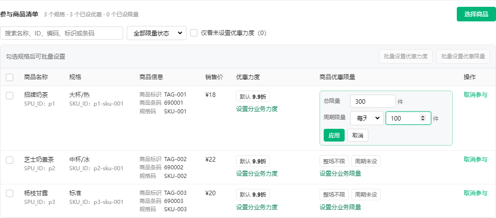
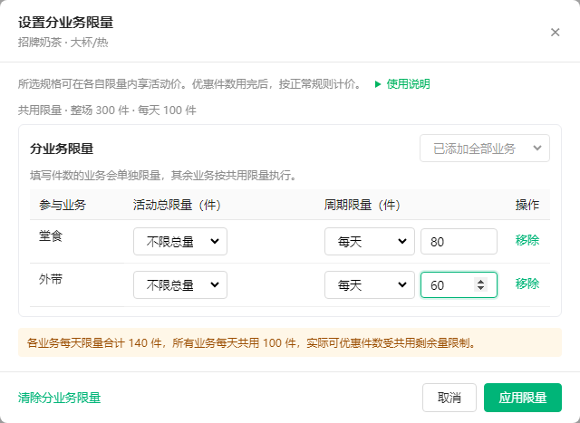
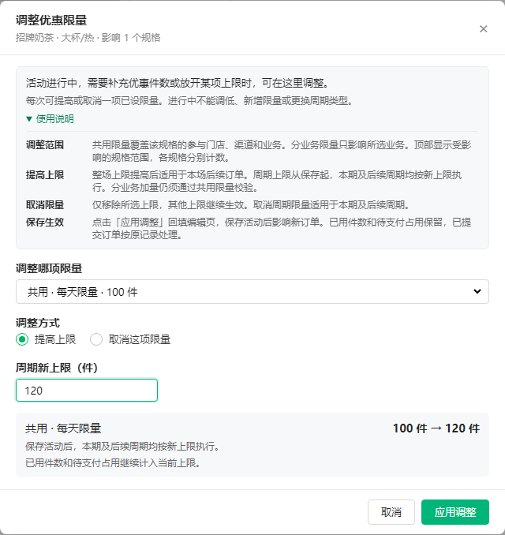

# 限时折扣商品优惠限量 PRD

**v1.2 · 2026-11-26 · 需求评审稿**

**目标**　运营可为一场限时折扣中的商品规格设置整场或周期内的优惠件数，并按堂食、外带、外卖等参与业务加设上限。额度用完后，商品按当前适用的计价规则继续销售。

**涉及端**　商家营销后台、顾客点餐与结算。适用于限时折扣的折扣、减价、指定价格三种优惠方式。

**原型**　进入「营销管理 → 促销活动 → 限时折扣」。草稿可设置限量，进行中的活动可编辑「商品与优惠」里的已有上限。[本地原型](http://127.0.0.1:5173/?type=limit-discount) · [线上原型](https://promo.yangyaojun-demo.cn/?type=limit-discount)

## 待确认事项

| 待确认决策 | 评审口径及影响 |
| --- | --- |
| 周期刷新时点与归属 | 建议按活动统一时区的自然日、自然周、自然月刷新，以订单占用发生时的周期归属计数和回补。确认前按[额度周期与刷新](#额度周期与刷新)的示例评审，核对历史活动的刷新点。 |
| 正式订单与退款链路 | 核对各参与渠道能否实时校验共用余额，重点验证 POS 等渠道存在离线交易时的行为。验证同一规格能否按优惠件和正常计价件记录成交明细、按实际退回的优惠件数恢复额度。提高或取消限量后，须能核对原订单的占用和回补归属。占用时点、分段计价及部分退款的细节按[消费端](#消费端)草案联调。 |
| 存量活动库存的映射 | 核实历史「活动库存」两处数值的含义、门店间的共享口径，以及正在占用和已用件数的归属。正式迁移以核对后的配置及用量映射为准，见[存量活动与上线](#存量活动与上线)。 |

## 变更记录

| 版本 | 主要变化 |
| --- | --- |
| v1.2 · 2026-11-26 | 周期限量修改后，本期及后续周期按新上限执行，已用件数及待支付占用继续计数。 |
| v1.1 · 2026-11-26 | 进行中的活动支持提高或取消已有上限。周期限量加量仅在本期生效，取消限量适用于本场后续订单。调整弹窗提供使用说明和生效预览。 |
| v1.0 · 2026-11-26 | 明确每规格计数、共用限量与业务上限、每天／每周／每月限量、商家配置及订单回补，补充首版试算和验收案例。 |

## 背景与目标

品牌做「珍珠奶茶八折」时，希望一场活动内，某个规格每天最多优惠 100 杯。精细运营的品牌还希望堂食、外带分别有自己的上限。运营需要在设置优惠力度时一起确定投放量，知道某个规格、某类订单最多可优惠多少件。顾客遇到优惠用完时仍可购买，结算价和取消、退款后的恢复结果均能核对。

对商家而言，配置可在一处完成，并能在提交前核对各规格的计数方式。对交易而言，各门店和渠道加起来的优惠件数受同一活动限量约束，取消与退款恢复对应的优惠件数。[已确认口径及原型验证记录](../analysis/限时折扣周期优惠额度-需求分析.md)

## 方案与共同规则

### 参与规格与计数范围

件数按**同一场活动下的同一商品规格（SKU）**计算。同一规格在活动内的各参与业务、渠道、门店及有效点餐区域使用该规格的共用限量，各业务再受自身已设置的限量约束。活动时间、参与资格、门店与点餐区域仍按本活动设置匹配。[门店区域限制规则](限时折扣区域限制-PRD.md)

| 参与商品范围 | 商家配置 | 实际计数 |
| --- | --- | --- |
| 全部商品 | 为全部参与规格设置一套默认限量。 | 每个符合参与条件的规格按该套配置独立计数。 |
| 指定商品 | 在参与商品清单逐规格配置，也可批量应用。 | 每个所选规格按自己的配置计数。 |
| 指定商品不参与 | 选择排除名单，为余下参与规格设置默认限量。 | 名单外每个参与规格独立计数，名单内规格按本活动之外适用的价格规则结算。 |

例如，默认整场限量 300 件，顾客分别购买珍珠奶茶中杯、大杯、椰子水各 1 件，三件都享活动价时，三个规格各用 1 件、各剩 299 件。若活动排除椰子水，则两种奶茶各用 1 件、各剩 299 件，椰子水使用其正常计价规则。

### 共用限量与分业务限量

| 限量范围 | 活动总限量 | 周期限量 |
| --- | --- | --- |
| 共用限量 | 该规格在整场活动中，所有参与业务合计可优惠的件数。 | 该规格在每个选定周期中，所有参与业务合计可优惠的件数。 |
| 分业务限量 | 该规格在整场活动中，该业务可优惠的件数上限。 | 该规格在每个选定周期中，该业务可优惠的件数上限。 |

- 总限量和周期限量均可独立设置。共用限量和每个业务各选一种周期，支持每天、每周、每月。订单只使用已设置且适用于本单的限制。
- 业务达到自己的上限后，该业务的超额件数按正常规则计价，即使共用额度仍有余额。其他业务可在各自上限与共用余额内继续享受优惠。未单独设置限量的业务使用共用余额。
- 配置值允许出现共用每天 100 件、堂食每天 80 件、外带每天 60 件。80 件和 60 件是业务能用到的上限。若堂食先用完 80 件且外带尚未用量，此时外带最多再优惠 20 件。共用额度约束优惠已用与待支付占用的实际合计。

### 额度周期与刷新

以下刷新及归属口径供交易联调。所有共用及业务周期按活动统一时区计算，示例按北京时间。

| 周期 | 用量窗口及刷新时点 |
| --- | --- |
| 每天 | 自然日，每日 00:00 进入新一期。 |
| 每周 | 自然周，周一 00:00 进入新一期。 |
| 每月 | 自然月，每月 1 日 00:00 进入新一期。 |

新一期按所设周期件数计算可用额度，上一期剩余件数到期失效。活动总用量贯穿整场活动。订单须处于配置的活动起止、参与时段和生效日期内。活动开始或结束落在周期中间时，在有效时段内按该期上限执行。暂停后在同一期恢复时继续按原期用量计算，跨期恢复时使用当前周期，活动总量继续累计。

### 本单可优惠件数

订单先匹配活动状态、渠道、业务、门店及区域、商品和用户资格，再按已有门槛、用户限购及优惠互斥规则确定可参加本活动的件数。同一规格出现在一单的多条明细时，合计受这一规格的限量约束。

**某项剩余件数 = max（0，限量 − 已用件数 − 待支付占用件数）**

**本单可优惠件数 = 符合其他优惠条件的件数及各项适用剩余件数中的最小值。**

适用项包括该规格的共用总限量、共用本期、该业务总限量及该业务本期。没有适用限量时，可优惠件数按原有优惠规则计算。活动价用尽后，商品可按其他适用优惠结算，没有其他适用优惠时按门店当前售价结算。商品可售量由实际商品库存决定。

## 需求说明

### 商家端

#### 配置入口与共用限量

具备活动编辑权限的运营在「基础信息与规则」选择参与业务，在「商品与优惠」选择参与商品范围。指定商品时，从目标规格的「商品优惠限量」单元格配置。全部商品或指定商品不参与时，在默认配置区设置，分别提示「适用于全部参与规格，各规格分别计数」或排除名单外的适用范围。

- 未配置时显示「整场不限」「周期未设」。点击整场或周期标签，在当前位置展开两项，焦点落到点击的字段。同一时间展开一个配置区。
- 行内「总限量」以件为单位，留空表示不限。周期下拉可选「不设置」「每天」「每周」「每月」，选择周期后需填写件数。点「应用」更新摘要，点「取消」回到原摘要。
- 清空总量和取消周期，仅清除共用限量。对应规格仍有分业务设置时，继续显示业务项数和生效规则。两类限量均为空时，规格归为「不限量」。
- 商品优惠限量与优惠力度可以分别编辑。全部商品、指定商品不参与选择「指定价格」时，默认特价留空。可先配置限量或保存草稿，填写特价后才能进入提交复核。

*图 1 · 招牌奶茶的共用限量在单元格内编辑，「应用」后回显。其他规格各自显示限量状态。*

**验收条件**　对指定商品中的一个规格设置整场 300 件、每天 100 件，另外两个规格仍显示自己的配置。全部商品和指定商品不参与可在统一配置区编辑，保存后按「参与规格与计数范围」的规则生效。

#### 分业务限量

点击「设置分业务限量」打开弹窗，弹窗顶部显示当前规格或统一配置的共用限量。已设置时入口显示「分业务限量（N）」，N 为配置了至少一项限量且仍参与活动的业务数。订单业务取自已选的「参与业务/场景」，每个业务可添加一次。每行可选择「不限总量」或「限制总量」，并独立选择周期及填写件数。

- 「移除」清除该业务配置，「清除分业务限量」清除弹窗内各参与业务的限量。点击「应用限量」后生效，取消时保留打开弹窗前的配置。
- 业务被移出参与范围后，其限量在当前活动中停止生效，且从业务项数及有效配置校验中扣除。
- 调低共用限量导致已有业务超出上限时，行内列明业务和超限原因，阻止应用。点击「调整分业务限量」将尚未应用的共用限量带入弹窗。修正后可一次应用两层配置，取消弹窗则回到行内继续编辑。

*图 2 · 各业务上限合计 140 件，实际合计每天共用 100 件。这组配置可应用。*

**验收条件**　堂食每天 60 件、共用每天 100 件时，改共用为 50 件，系统提示堂食超限。进入业务弹窗可看到待应用的 50 件。将堂食改为 40 件后，两项一起应用。

#### 字段校验与保存

| 条件 | 提示和保存结果 |
| --- | --- |
| 已启用的限量未填件数，或输入 0、负数、小数 | 在对应字段提示填写件数或修正为正整数。总量和周期字段分别显示校验结果，修正后才能应用。 |
| 同一范围的周期限量超过活动总限量 | 阻止应用。例如共用整场 300 件、共用每天 400 件时，提示每天限量最多 300 件。 |
| 单项业务限量超过能覆盖它的共用限量 | 阻止应用并指出业务及可设上限。共用每天 100 件时，堂食每天最多设 100 件。共用每周 11 件时，堂食每天最多设 11 件。共用活动总限量也约束各业务的总量与周期限量。 |
| 业务周期与共用周期不同，业务周期无法完整落在对应共用周期内 | 两项可分别设置，结算同时受两项余额约束。例如共用每天 100 件、外卖每周 150 件可保存。自然周可能横跨两个月，周与月按各自周期处理。 |
| 各业务上限分别有效，同一周期或整场上限合计超过共用限量 | 允许应用和保存。提示「各业务每天限量合计 140 件，所有业务每天共用 100 件，实际可优惠件数受共用剩余量限制」。 |

单规格、统一配置、批量应用和提交使用同一套校验。额度选项可全部留空。已启用且有错误的额度须修正后才能应用及保存。草稿可继续补充未配齐的活动项，正式保存和发布前需通过整场活动校验。

#### 批量设置与筛选

「指定商品」支持按商品名称、ID 或编码等检索，可使用「全部限量状态」「已设限量」「不限量」筛选。一个规格的任一有效限量有值时归为「已设限量」，商品参与范围和限量状态各自判断。

勾选规格后，商品清单上方显示已选数量及「批量设置优惠限量」。表头勾选作用于当前页可编辑规格，可继续全选其他页或筛选结果。切换筛选后保留已有勾选，并提示筛选结果外仍会参与批量设置的规格数。「清空选择」清除全部勾选。

弹窗显示应用规格数及会被替换的已有配置数。应用后用这次的共用与分业务设置替换选中规格的配置，各规格继续独立计数。可统一设为不限量，确认前可取消。

**验收条件**　跨两页勾选 40 个可编辑规格，改筛选后提示筛选外已选项数量。对这 40 个规格应用每天 100 件后，所有目标规格分别显示每天 100 件，可在「已设限量」中筛出，其他规格保持原配置。

#### 配置复核、查看与复制

- 「提交保存 → 配置复核」中，指定商品展示已设限量规格数及逐规格摘要。全部商品和指定商品不参与展示「默认商品优惠限量（每规格）」。如设分业务限量，可展开核对每项数值。
- 已设限量时可展开「试算优惠件数」。选择参与规格与订单业务，填写购买件数及假设已用件数，查看预计按活动价和正常价结算的件数及相应单价。试算以订单满足其他优惠条件为前提。
- 活动列表「查看」中可核对已保存的限量配置。草稿和待发布活动可编辑额度。进行中的活动可按下节调整已有上限。已发布且未开始、暂停的活动中，已有规格和共用限量锁定。指定商品范围可追加新规格并配置其额度。
- 复制活动时带入已保存的整场与周期限量。新活动按自己的实际成交及占用计数。续期延长同一活动的有效期，活动总用量继续累计。

**验收条件**　在试算中为单价 20 元、八折的规格填入购买 3 件、当前适用余额 2 件，页面显示 2 件按 16 元、1 件按 20 元，据此计算商品合计 52 元。复制后可在副本继续编辑额度，原活动配置和已用件数独立核对。

#### 进行中调整优惠限量

有活动编辑权限的运营在进行中活动的「商品与优惠」点击「调整限量」。指定商品逐规格操作，全部商品和指定商品不参与可调整默认配置，弹窗显示当前覆盖的规格数。商家从已设置的共用或分业务上限中选择一项，核对变更前后的上限及生效范围。应用后可在配置复核中查看结果，保存活动后生效。保存前可撤销本项调整。

弹窗顶部显示适用场景和调整边界。展开「使用说明」可查看共用与分业务的影响范围、提高和取消上限的结果，以及保存后对新旧订单的影响。表单下方根据所选限量项和调整方式，预览上限变化和生效范围。

| 已设限量项 | 提高上限 | 取消这项限量 |
| --- | --- | --- |
| 整场总限量 | 新值适用于本场后续订单，整场用量继续累计。 | 从保存起取消该整场上限。 |
| 周期限量 | 从保存起，本期及后续周期均按新上限执行。当前周期已用件数及待支付占用继续累计。 | 从保存起，本期及后续周期均取消该项上限。 |

*图 3 · 展开「使用说明」后可核对调整规则。招牌奶茶的共用每天限量从 100 件提高到 120 件，保存后本期及后续周期均按 120 件执行。*

每项上限独立判断。活动进行中禁止调低已设置的上限、切换周期类型，以及给未设或已取消的限量项新增配置。提高业务上限仍需校验共用限量，其他适用上限继续约束本单。保存时核对最新活动，防止覆盖其他运营已经保存的调整。

额度继续按既有的已用和待支付占用计量。取消某项上限后，新订单跳过该项。此前已提交订单的成交和占用按原记录处理，取消及退款按原扣减归属回补。

**验收条件**　共用每天 100 件、已用和占用合计 90 件，提高至 120 件后，共用当期余额为 30 件，下期按 120 件刷新，仍受整场和分业务剩余量约束。取消共用每天限量后，原先已设的整场和分业务上限继续参与计算。保存后重开活动，已取消项无法重新配置。选择 80 件时拦截，原本不限量的规格也无法新增限量。

在本地原型的「进行中」筛选中可打开以下样例。若原有下午茶活动已经编辑过，可打开独立的「指定商品限量调整示例」体验相同配置。

| 样例活动 | 可体验的配置 |
| --- | --- |
| 下午茶限时折扣 | 招牌奶茶仅设每天，芝士奶盖茶仅设整场，鲜果茶仅设每周，雪顶咖啡仅设每月。杨枝甘露只设外卖（配送）整场与每周上限。芋泥波波同时设置共用与分业务限量。可乐原本不限量。 |
| 全部商品限量调整示例 | 在统一配置区调整所有参与规格的共用整场、每日上限及堂食上限。 |
| 排除商品限量调整示例 | 在统一配置区调整排除名单之外的共用每月上限，以及外卖配送、自取的分业务上限。 |

### 消费端

#### 点餐及结算价格

商品列表和购物车可展示按当前余额预计的活动价。顾客确认订单时，系统根据最新资格与额度重新计算。若仍有商品库存但限量已用完，展示该商品按当前适用规则结算的价格。若可用优惠件数不足以覆盖整笔购买量，拟对可优惠件数与超额件数分别计价，并在优惠明细中展示。

例如「本单 2 件享限时折扣，另 1 件按当前价格结算」。从购物车进入结算时，若余额变化导致价格调整，先展示更新后的价格及原因，由顾客确认再提交。额度暂时无法核实时，提示稍后重试并保留购物车。具体分段计价及渠道保障按文首待确认事项联调。

#### 订单占用与退款回补

未付款订单取消及已付款订单退款成功后需恢复额度。下表明确订单环节的评审口径，涉及周期归属及退款明细的细节待正式链路验证。

| 订单状态或事件 | 用量变化 |
| --- | --- |
| 浏览、加购或试算 | 返回预计优惠。额度从创建待支付订单时开始占用。 |
| 创建待支付订单 | 按订单实际享活动价的件数，同时占用该规格适用的共用和该业务各项额度。占用归属创建订单时适用的周期。 |
| 支付成功 | 将本单已占用的优惠件数转为已用，继续归属原订单的活动、规格、业务和周期。 |
| 未支付订单取消或超时关闭 | 释放本单对应的待支付占用。 |
| 已支付订单全退成功 | 恢复本单实际享受活动价的件数。退款处理中或失败时保留已用量。 |
| 已支付订单部分退款成功 | 按退回明细中实际享受活动价的件数恢复。退款金额沿用原成交明细，金额调整且商品件数未退回时按原用量处理。 |

恢复时，活动累计用量回补至原活动及规格，周期用量回补至原订单所属的相应周期。跨日、跨周或跨月退款时，按各适用限制分别归属。例如周二下单、周三退回 2 件优惠商品，共用日额度回补至周二。同一业务若按周限量且仍在原周，原周业务额度增加 2 件。

两家门店或不同渠道同时抢最后一份优惠时，最多一单可占用。重复提交同一订单，或重复收到同一笔支付、取消、退款通知时，用量变化各生效一次。部分退款多次成功时，累计恢复数量以该订单对应的实际优惠件数为上限。

#### 交易验收场景

| 场景 | 前置条件 | 预期结果 |
| --- | --- | --- |
| 业务先达到上限 | 同一规格共用每天 100 件，堂食每天 60 件，堂食已用 60 件，外带尚未使用。 | 堂食第 61 件按正常规则计价。外带仍可在自身上限及剩余共用额度内享受优惠。 |
| 共用额度先达到上限 | 共用每天 100 件，堂食上限 80 件、外带上限 60 件，堂食先用 80 件。 | 外带最多再优惠 20 件，同规格合计已用与占用最多 100 件。 |
| 共用与业务周期不同 | 活动总量充足，共用当天剩 20 件、外卖当周剩 12 件，本单符合条件的购买数为 15 件。 | 12 件优惠，3 件按正常规则计价。共用当日剩 8 件，外卖当周剩 0 件。 |
| 跨期刷新 | 整场上限 300 件，活动累计已用 280 件，当天 100 件周期额度已经用完。 | 新日初始周期额度为 100 件，受活动累计余额限制，最多再优惠 20 件。 |
| 并发、取消与重试 | 两家门店同时请求同一规格最后 1 件优惠。成功占用的订单随后未支付取消。 | 只允许一单占用最后 1 件，另一单需确认更新后的金额。取消成功后可再次占用，重复取消仅释放一次。 |
| 部分退款和跨期 | 订单有 2 件按活动价、1 件按正常规则计价。次日分别退回 1 件优惠商品和 1 件正常计价商品。 | 只恢复 1 件优惠额度，回到原活动累计及相应原扣减周期。本日共用日限量按本日用量计算。 |

## 存量活动与上线

- 无历史限量配置的活动按不限量解析。有历史「活动库存」的活动以核实后的字段含义、周期边界和有效用量为准。核对期间继续按原额度与订单归属口径处理，尤其需要区分原字段留空、售罄及已设置周期的情况。
- 迁移时可核对共用及分业务的总量、周期、已用和待支付占用。对仍可成交的存量活动，切换后可优惠件数以原有有效用量与已占用订单为基础。已创建订单的成交价格、占用及退款归属以原订单为准。
- 放量前，用真实测试订单核对跨门店与跨端并发、跨自然日／周／月、活动暂停与恢复、超时取消、部分退款及重复退款。商家端页面和试算以本版原型为评审依据，正式交易以联调及生产验收结果为准。
